# HealthConnect Ghana — Technical Documentation

## 1. Project Overview

HealthConnect Ghana is an offline-first Progressive Web App (PWA) and cloud backend built for community primary healthcare in Ghana. Community Health Volunteers (CHVs) working in rural areas with weak or intermittent 2G/3G connectivity use the application on Android phones to capture patient consent, register patients, record vital signs, photograph wounds, book clinic visits, escalate urgent referrals, and join low-bandwidth teleconsultations with nurses and doctors. District Health Officers view anonymised weekly disease surveillance summaries with automatic small-cell suppression and fever outbreak alerts, while administrators audit every data access and permission refusal against a tamper-evident hash chain.

### 1.1 Team Ownership

| Area | Owner | Repository Paths |
|---|---|---|
| Frontend PWA, UI Design, Cloud Infrastructure, CI/CD, Serverless Functions | Mubarak Tijani | `frontend/`, `deploy/`, `.github/`, `functions/` |
| Backend API, Authentication, Media Signing, WebRTC Signalling, Event Publishing | Bernard Marfo Adjei | `backend/` |
| Database Schema, RBAC & Row-Level Security, Sync Conflict Policy, Surveillance Analytics | Liza Aikins | `db/`, `backend/Services/Libs/Data/Migrations/Sql/` |
| Security Architecture, Act 843 Compliance, Role Matrix, Consent & Audit Verification | Germain Emil Allotey-Pappoe | `docs/`, `deploy/verify/`, `labs/lab6/` |

### 1.2 Live Environments

All cloud resources run in AWS account `659500703236` in the **Africa (Cape Town) — `af-south-1`** region, the geographically closest AWS region to Ghana, with global edge delivery and edge metrics in `us-east-1`.

| Environment | Public URL | Source Branch | Trigger | Host Port | PostgreSQL Database |
|---|---|---|---|---|---|
| **Production** | `https://d2opah5iezm17k.cloudfront.net` | `main` | Manual approval on GitHub Environment `production` | `80` | `healthconnect` |
| **Staging** | `https://dwaho59wvxpxe.cloudfront.net` | `development` | Automatic on every merge to `development` | `8081` | `healthconnect_staging` |
| **Local Development** | `http://localhost:5173` (UI) / `http://localhost:8000` (API) | Working branch | `npm run dev` / `dotnet run` | `5173` / `8000` | `healthconnect` (`localhost:5433`) |

**Repository and presentation:** the source, infrastructure code and documentation are at <https://github.com/ASU-MICS-2028/cc-group-1-prosit-2>. The team's presentation slides are in the repository at [`docs/presentation/HealthConnect_Ghana_Presentation.pptx`](https://github.com/ASU-MICS-2028/cc-group-1-prosit-2/blob/development/docs/presentation/HealthConnect_Ghana_Presentation.pptx).

### 1.3 Scope and Boundaries

- **Synthetic Data Only:** Every patient, vital sign reading, appointment, referral, and health worker account in the repository and live databases is synthetic. Seeded patient surnames end in `-Demo`, and demo health worker phone numbers use the reserved range `+233200000101` to `+233200000105`.
- **Regulatory Alignment:** Data collection, consent evidence, statistical suppression, and audit trails are engineered around **Ghana's Data Protection Act, 2012 (Act 843)** and **HL7 FHIR R4** resource shapes. The system does not claim formal HIPAA certification or clinical device validation.
- **External Integrations:** SMS delivery supports live gateways (**httpSMS**, with optional end-to-end AES-256-CFB message encryption when an `encryptionKey` is set, and **Arkesel** bulk SMS) alongside a safe log-only mode when no SMS secret is provisioned. Teleconsultation fees are paid by **mobile money through Paystack** (GHS 20 per teleconsult, emergencies exempt; switched on per environment by the `healthconnect/<env>/paystack` secret). National Health Insurance Scheme (NHIS) eligibility checks, hospital EHR interoperability, and pharmacy stock systems are outside the scope of this build; prescriptions carry a code (`RX-XXXX-XXXX`) that a pharmacy reads, and a worker records when it was dispensed.

---

## 2. Cloud Architecture and Infrastructure

All infrastructure is managed as code with Terraform (`~> 1.14`, AWS provider `~> 6.0`) in `deploy/terraform/`, with remote state stored in the versioned, encrypted S3 bucket `healthconnect-tfstate-659500703236` (`deploy/terraform/bootstrap/main.tf`). Every resource carries the default tags `Project = healthconnect`, `Team = Godabeg`, and `ManagedBy = terraform`.

```mermaid
flowchart LR
    Phone["CHV / Clinician Phone<br/>(PWA + IndexedDB)"]
    CF["Amazon CloudFront<br/>Prod & Staging Distributions<br/>(HTTPS Only, PriceClass_200)"]
    VPCOrigin["CloudFront VPC Origin<br/>(Private ENI in VPC)"]
    ALB["Internal ALB<br/>(healthconnect-int :80)<br/>Routes X-HC-Env: staging -> :8081"]

    subgraph VPC["VPC 10.30.0.0/16 (af-south-1, 2 AZs)"]
        subgraph PubSub["Public Subnets (10.30.0.0/24, 10.30.1.0/24)"]
            NAT["fck-nat Instance<br/>(t4g.nano, ASG ha_mode)"]
        end
        subgraph AppSub["Private App Subnets (10.30.10.0/24, 10.30.11.0/24)"]
            VPCOrigin --> ALB
            ALB -->|:80 Prod / :8081 Staging| EC2["App Server (t4g.small, arm64)<br/>Docker Compose: nginx + .NET 10 API<br/>IMDSv2 + SSM Only (No SSH)"]
        end
        subgraph DbSub["Private DB Subnets (10.30.20.0/24, 10.30.21.0/24 — No Internet Route)"]
            RDS[("RDS PostgreSQL 17<br/>(db.t4g.micro, gp3 20 GB)<br/>KMS Encrypted, rds.force_ssl=1")]
        end
        S3GW["S3 Gateway VPC Endpoint"]
        TURN["TURN relay: coturn<br/>(t4g.micro, public subnet, Elastic IP)<br/>UDP/TCP 3478 + UDP 49160-49999"]
    end

    S3[("S3 Media Bucket<br/>(Private, SSE-KMS, Versioned)")]
    SM["AWS Secrets Manager<br/>(RDS Password, SMS, Paystack, TURN)"]
    DR[("eu-west-1 (Ireland)<br/>Replicated RDS Backups<br/>alias/healthconnect-dr-backups")]
    SNS["SNS Appointment Events<br/>(KMS Encrypted)"]
    SQS1["SQS Reminders + DLQ"]
    SQS2["SQS Specialist Notify + DLQ"]
    L1["Lambda: appointment-reminder<br/>(Python 3.12 arm64)"]
    L2["Lambda: specialist-notify<br/>(Python 3.12 arm64)"]
    Sched["EventBridge Scheduler<br/>(One-off Reminder Schedules)"]
    DDB[("DynamoDB: processed-events<br/>(On-Demand, TTL 30d)")]
    ClinSNS["SNS Clinician Alerts<br/>(Email)"]

    Phone <-->|HTTPS / WSS| CF
    CF --> VPCOrigin
    Phone -->|Presigned PUT (5 min)| S3
    EC2 -->|TLS verify-full :5432| RDS
    EC2 --> S3GW --> S3
    EC2 -->|HTTPS via NAT| SM
    EC2 -->|Publish Events| SNS
    SNS --> SQS1 --> L1
    SNS -->|Filter: referral/teleconsult| SQS2 --> L2
    L1 <--> Sched
    L1 --> DDB
    L2 --> DDB
    L2 --> ClinSNS
    Phone <-.->|WebRTC media when no direct path| TURN
    RDS -.->|Automated backups copied| DR
```

### 2.1 Network Topology (`deploy/terraform/network.tf`, `nat.tf`)

- **VPC (`10.30.0.0/16`):** Separate from other workloads in the account, spanning two availability zones (`af-south-1a`, `af-south-1b`) with DNS support and hostnames enabled.
- **Public Subnets (`10.30.0.0/24`, `10.30.1.0/24`):** Do not auto-assign public IPs (`map_public_ip_on_launch = false`). Host only the `fck-nat` network address translation instance (`t4g.nano`, module `RaJiska/fck-nat/aws ~> 1.3` with `ha_mode = true` in a self-healing Auto Scaling Group of 1). Using `fck-nat` costs ~$0.13/day instead of ~$43/month plus per-GB charges for a managed AWS NAT Gateway.
- **Private App Subnets (`10.30.10.0/24`, `10.30.11.0/24`):** Host the internal Application Load Balancer and the `healthconnect-app` EC2 server. Outbound internet traffic (ECR image pulls, OS updates, AWS APIs, SMS gateways) routes through `fck-nat`, while all S3 traffic routes free of charge over the private **S3 Gateway VPC Endpoint** (`com.amazonaws.af-south-1.s3`).
- **Private Database Subnets (`10.30.20.0/24`, `10.30.21.0/24`):** Host the RDS PostgreSQL 17 instance. The `healthconnect-db` route table contains only the local VPC route—there is no route to the Internet Gateway or `fck-nat`.
- **TURN Relay (`deploy/terraform/turn.tf`):** One `t4g.micro` Graviton instance in a public subnet with an Elastic IP, shared by production and staging, runs **coturn** as a container. Phones on mobile data in Ghana sit behind carrier-grade NAT, so two of them usually cannot reach each other directly; the relay carries the call's audio and video only when no direct path exists. It uses the TURN REST scheme (`use-auth-secret`): the API gives every call ticket its own short-lived relay login (4 hours) made from a shared secret in Secrets Manager (`healthconnect/turn`), so nothing is stored on the relay and a copied login expires. Cost: ~$7.88/month for the instance plus $3.65/month for the public IPv4, and data out only for relayed calls.

### 2.2 Security Groups (`deploy/terraform/network.tf`)

| Security Group | Ingress Allowed | Egress Allowed |
|---|---|---|
| `healthconnect-alb` | TCP `80` from AWS-managed prefix list `com.amazonaws.global.cloudfront.origin-facing` only | TCP `80` (production) and TCP `8081` (staging) to `healthconnect-app` |
| `healthconnect-app` | TCP `80` and TCP `8081` from `healthconnect-alb` only (no port 22 / SSH) | TCP `443` to `0.0.0.0/0` (HTTPS for AWS APIs, OS packages, SMS) and TCP `5432` to `healthconnect-db` |
| `healthconnect-db` | TCP `5432` from `healthconnect-app` only | None |
| `healthconnect-turn` | UDP and TCP `3478` (STUN/TURN) and UDP `49160–49999` (relayed media) from anywhere | All (relayed media back to the phones, package and image downloads) |

### 2.3 Edge Delivery and Internal Load Balancing (`cloudfront.tf`, `alb.tf`)

- **CloudFront Distributions:** Two distributions (`production` and `staging`) configured with `PriceClass_200` (which includes African edge locations such as Johannesburg, Lagos, Nairobi, and Cairo), `http2and3`, and IPv6.
- **CloudFront VPC Origin (`aws_cloudfront_vpc_origin.alb`):** CloudFront connects privately into the VPC to reach the internal load balancer (`healthconnect-int`, `internal = true`). Neither the load balancer nor the EC2 instance has a public IPv4 address, eliminating direct-to-origin bypass attacks and saving public IPv4 charges (~$0.24/day).
- **Environment Routing:** The staging CloudFront distribution attaches custom origin header `X-HC-Env: staging`. The internal ALB listens on port `80` (`drop_invalid_header_fields = true`, `idle_timeout = 60s`), forwarding requests with `X-HC-Env: staging` to target group `healthconnect-staging` (`:8081`) and all other requests to `healthconnect-production` (`:80`).
- **Transport Enforcement & Caching:**
  - Default behavior (`/*`): `viewer_protocol_policy = "redirect-to-https"` (`301 Moved Permanently`), honours origin `Cache-Control` headers (`Managed-UseOriginCacheControlHeaders`).
  - API behavior (`/api/*`): `viewer_protocol_policy = "https-only"` (plain HTTP requests receive `403 Forbidden` immediately rather than redirecting a request body containing patient data), caching disabled (`Managed-CachingDisabled`), forwards all viewer headers except `Host` (`Managed-AllViewerExceptHostHeader`).
  - Health behavior (`/health`): `redirect-to-https`, caching disabled.
  - Response headers: HSTS (`max-age=31536000`), `X-Content-Type-Options: nosniff`, `X-Frame-Options: SAMEORIGIN`, `Referrer-Policy: strict-origin-when-cross-origin`, `X-XSS-Protection: 1; mode=block`, plus `X-Robots-Tag: noindex, nofollow` on staging.

### 2.4 Compute and Container Runtime (`compute.tf`, `deploy/compose.yml`, `deploy/server-boot.sh.tftpl`)

- **Single Graviton Host:** One `t4g.small` (`arm64`, 2 vCPUs, 2 GB RAM) running Amazon Linux 2023 (`al2023-ami-kernel-default-arm64`), 20% cheaper than `t3.small` in `af-south-1`.
- **Instance Hardening:**
  - IMDSv2 enforced (`http_tokens = "required"`, `http_put_response_hop_limit = 2` so containers on the bridge network can reach the metadata service).
  - 20 GB `gp3` root volume encrypted with customer-managed KMS key `alias/healthconnect-data`.
  - No SSH key pair and no inbound port 22. Interactive shell access and automated deployments use **AWS Systems Manager (SSM)** Session Manager and Run Command.
- **First Boot (`server-boot.sh.tftpl`):**
  - Installs Docker, Docker Compose CLI plugin, `postgresql16` client, and `jq`.
  - Configures `/etc/docker/daemon.json` with `"log-driver": "awslogs"` (`mode: "non-blocking"`, group `/healthconnect/app`).
  - Downloads the regional RDS TLS certificate bundle (`https://truststore.pki.rds.amazonaws.com/af-south-1/af-south-1-bundle.pem`) to `/opt/healthconnect/rds-ca.pem`.
  - Writes `/opt/healthconnect/{production,staging}/settings.env` containing non-secret configuration (`APP_ENV`, `HOST_PORT`, `AWS_REGION`, `DB_HOST`, `DB_NAME`, `DB_SECRET_ARN`, `DB_SSL_CA`, `MEDIA_BUCKET`, `REGISTRY`). No password is ever written to disk.
- **Container Isolation (`deploy/compose.yml`):**
  - Production (`-p healthconnect-production`, port `80`) and staging (`-p healthconnect-staging`, port `8081`) run as separate Docker Compose projects with isolated bridge networks.
  - **`frontend` container:** Built from `node:24-alpine` and served by `nginxinc/nginx-unprivileged:stable-alpine` (runs as UID `101`, port `8080`). Hardened with `read_only: true`, `tmpfs: [/tmp, /var/cache/nginx]`, `cap_drop: [ALL]`, `security_opt: ["no-new-privileges:true"]`, `mem_limit: 128m`.
  - **`backend` container:** Built from `mcr.microsoft.com/dotnet/sdk:10.0` and run on `mcr.microsoft.com/dotnet/aspnet:10.0-alpine` (runs as non-root `$APP_UID`, port `8080`, `DOTNET_gcServer=0`, `DOTNET_EnableDiagnostics=0`). Hardened with `read_only: true`, `tmpfs: [/tmp]`, `cap_drop: [ALL]`, `security_opt: ["no-new-privileges:true"]`, `mem_limit: 512m`, and mounts `/opt/healthconnect/rds-ca.pem:ro`.

### 2.5 Reverse Proxy Routing (`frontend/.nginx/nginx.conf`)

The frontend nginx container serves both the static PWA and proxies `/api` to the backend container over Docker's internal DNS (`resolver 127.0.0.11 valid=10s`), eliminating cross-origin (CORS) requests for API calls:

- `GET /health`: answered directly by nginx (`200 "ok\n"`) for the ALB target group health check so the PWA remains reachable offline/online even if the backend is restarting.
- `GET /api/health`: proxied to `http://backend:8080/health` for deployment verification.
- `GET /api/calls/<uuid>/ws`: proxied to `http://backend:8080` with `Upgrade` and `Connection: upgrade` headers, 1-hour read/send timeouts (`proxy_read_timeout 1h`), and `access_log off` so one-time call tickets in query strings are never logged.
- `/api/*`: proxied to `http://backend:8080` with `X-Real-IP` and `X-Forwarded-For` trusted only from VPC CIDR `10.0.0.0/8` (`set_real_ip_from 10.0.0.0/8`). If the backend container is unreachable or returns `502`/`503`/`504`, `proxy_intercept_errors on` returns `503 {"error":"api_unavailable"}` with `Retry-After: 30` instead of an HTML error page, allowing the PWA sync engine to treat it as offline and retry cleanly.
- `/assets/*`: served with `Cache-Control: public, max-age=31536000, immutable`.
- `/index.html` and `/sw.js`: served with `Cache-Control: no-cache` so browsers always revalidate the app shell and service worker.

### 2.6 Database and Object Storage (`database.tf`, `storage.tf`, `ecr.tf`)

- **RDS PostgreSQL 17 (`healthconnect-db`):**
  - Instance class `db.t4g.micro`, 20 GB `gp3` storage encrypted at rest with `alias/healthconnect-data`.
  - Parameter group `healthconnect-postgres17` enforces `rds.force_ssl = 1` (rejects any non-TLS connection) and `log_connections = 1`.
  - Master password managed by RDS in Secrets Manager (`manage_master_user_password = true`, encrypted with `alias/healthconnect-data`), so the password never exists in Terraform state or environment variables.
  - Automated daily backups (`01:00–01:30 UTC`), 7-day point-in-time recovery (PITR), PostgreSQL logs exported to CloudWatch, `deletion_protection = true`, and final snapshot `healthconnect-db-final`.
- **S3 Media Bucket (`healthconnect-group1-media-659500703236`):**
  - All four S3 Public Access Block settings enabled; ACLs disabled (`BucketOwnerEnforced`).
  - Default encryption `aws:kms` using `alias/healthconnect-data` with `bucket_key_enabled = true`.
  - Versioning enabled; lifecycle rules abort incomplete multipart uploads after 7 days and expire noncurrent versions after 30 days.
  - Bucket policy explicitly denies all `s3:*` actions when `aws:SecureTransport = false`.
  - CORS rule `app-uploads` permits `PUT` only from the production and staging `https://*.cloudfront.net` origins with allowed headers `content-type`, `x-amz-server-side-encryption`, and `x-amz-checksum-sha256`.
- **ECR Repositories (`healthconnect/frontend`, `healthconnect/backend`):**
  - `image_tag_mutability = "IMMUTABLE"`, `scan_on_push = true`, AES256 encryption, lifecycle policy retaining the 15 most recent images.

---

## 3. Security, Privacy, and Ghana Act 843 Compliance

### 3.1 Ghana Data Protection Act, 2012 (Act 843) Controls

| Act 843 Provision | Legal Requirement | Implementation in HealthConnect |
|---|---|---|
| **s.20(1) & s.37(2)(b)** | Processing of special personal data (health data) requires explicit consent of the data subject unless performed by someone bound by medical professional confidentiality. | Because CHVs are community volunteers rather than licensed clinicians, patient registration cannot proceed without recording explicit consent (`consent.given = true`, method `spoken`, `signature`, or `thumbprint`, statement version `v1`, language, and cryptographic file evidence or a named witness). Enforced in the UI (`NewPatientPage.tsx`), API (`PatientValidator.CheckConsent`), and database (`consents_has_evidence` check constraint). |
| **s.20(2)–(3)** | Right to withdraw consent at any time. | `consents` is a separate one-to-many history table (`status IN ('active', 'inactive', 'rejected')`) rather than a single boolean, preserving the full history of consent decisions. |
| **s.19** | Minimality: only personal data necessary for the stated purpose may be collected. | Only fields required for triage, visit scheduling, and follow-up care are stored. `phone` (for SMS visit reminders) and `nationalId` (for NHIS/Ghana Card lookup) are optional. Religion, ethnicity, income, and GPS coordinates are not collected. The early draft's `nhis_number` column on `patients` was removed in favour of namespaced rows in `patient_identifiers`. Every thumbprint photo is stripped of EXIF metadata and re-encoded on the phone, and no biometric fingerprint template is ever captured. |
| **s.24(3)** | Statistical records must not permit identification of data subjects. | District Health Officers query `surveillance_weekly`, which aggregates counts by district and ISO week and suppresses any cell where fewer than 5 distinct patients were seen (`patients_seen < 5` returns `NULL` for all counts and `suppressed = true`). |
| **s.28** | Security safeguards and integrity of records. | TLS in transit everywhere (CloudFront HTTPS, `rds.force_ssl = 1` with `sslmode=verify-full`, S3 `DenyInsecureTransport`), KMS customer-managed encryption at rest, database-level Row-Level Security by district, and an append-only SHA-256 hash-chained `access_log` recording every view, write, sign-in, and refused access. |

### 3.2 Consent Capture and Cryptographic Evidence

During Step 1 of patient registration (`/patients/new`), the health worker reads **Consent Statement `v1`** in the patient's language:

> *"We would like to keep your health record on this phone and send it securely to the Ghana Health Service, so your health workers can follow up on your care. Only your health workers can see it. You can say no, and you can ask us to stop at any time. Do you agree?"*

Proof of consent is captured on the device in one of three ways:
1. **Spoken (`spoken`):** Up to 30 seconds of audio recorded via the browser's `MediaRecorder` API (`audio/webm;codecs=opus` or `audio/mp4`, ~60 KB). If the device has no working microphone, the form requires the full name of an adult `witness` who heard the patient agree.
2. **Signature (`signature`):** Drawn by the patient with a finger on an HTML5 `<canvas>` (`SignaturePad.tsx`) and exported as `image/png`.
3. **Thumbprint (`thumbprint`):** A photograph of the patient's inked thumbprint on a paper consent form (`PhotoCapture.tsx`), compressed on-device to `image/jpeg` (~150 KB).

When the file is captured on the phone, `src/lib/media.ts` computes its **SHA-256 hex digest** (`crypto.subtle.digest("SHA-256")`) and saves both the `Blob` in IndexedDB (`db.media`) and `{ mediaId, sha256, mime }` inside `patient.consent.evidence`. When synced, the API signs an S3 `PUT` URL pinned to that exact `Content-Type` and `x-amz-checksum-sha256`, and stores `evidence_sha256` in `consents`, so any subsequent tampering with the object in S3 is detectable.

### 3.3 Customer-Managed KMS Keys (`deploy/terraform/kms.tf`, `events.tf`)

| Key Alias | Resource | Purpose & Access Control |
|---|---|---|
| `alias/healthconnect-data` | `aws_kms_key.data` | Encrypts RDS storage & snapshots, RDS master secret in Secrets Manager, S3 media bucket (`SSE-KMS` with Bucket Keys), and the EC2 root EBS volume. Annual automatic rotation enabled; 7-day deletion window. The `healthconnect-app` IAM role may call `kms:Decrypt` and `kms:GenerateDataKey` on this key **only** when `kms:ViaService` is `secretsmanager.af-south-1.amazonaws.com` or `s3.af-south-1.amazonaws.com`. |
| `alias/healthconnect-dr-backups` (eu-west-1) | `dr.tf` | Re-encrypts the RDS automated backups copied to Ireland for cross-region disaster recovery. |
| `alias/healthconnect-events` | `aws_kms_key.events` | Encrypts SNS appointment-event and clinician-alert topics, SQS consumer queues and dead-letter queues, EventBridge Scheduler reminder schedules, and DynamoDB `processed-events` tables. Key policy grants `sns.amazonaws.com` `kms:GenerateDataKey*` and `kms:Decrypt` scoped to the AWS account. |

### 3.4 Least-Privilege IAM Roles (`deploy/terraform/iam.tf`, `events.tf`, `schedule.tf`)

1. **`healthconnect-app` (EC2 Instance Profile):**
   - `secretsmanager:GetSecretValue`, `DescribeSecret` on the single RDS master secret ARN.
   - `secretsmanager:GetSecretValue` on `arn:aws:secretsmanager:af-south-1:659500703236:secret:healthconnect/{production,staging}/sms-*` and `healthconnect/{production,staging}/paystack-*`.
   - `secretsmanager:GetSecretValue` on `healthconnect/turn-*` (the TURN relay's shared secret, to make each call ticket its own relay login).
   - `kms:Decrypt`, `kms:GenerateDataKey` on `alias/healthconnect-data` conditioned on `kms:ViaService` (`secretsmanager` or `s3`).
   - `s3:GetObject`, `s3:PutObject` on `arn:aws:s3:::healthconnect-group1-media-659500703236/*` (no `s3:DeleteObject`, no `s3:ListBucket`, no `s3:ListAllMyBuckets`).
   - `ecr:BatchGetImage`, `GetDownloadUrlForLayer`, `BatchCheckLayerAvailability` on the two HealthConnect ECR repositories, plus `ecr:GetAuthorizationToken`.
   - `logs:CreateLogStream`, `PutLogEvents` on `/healthconnect/app:*`.
   - `sns:Publish` on `healthconnect-{production,staging}-appointment-events` and `kms:GenerateDataKey`/`Decrypt` on `alias/healthconnect-events` via SNS.
   - Managed policy `AmazonSSMManagedInstanceCore` for SSH-free Session Manager and Run Command access.
   - **Explicitly absent:** No `rds:*` (cannot delete, modify, or snapshot databases), no `iam:*`, no access to other secrets or buckets in the account.
2. **`healthconnect-github-deploy` (GitHub Actions OIDC Role):**
   - Federated trust policy (`sts:AssumeRoleWithWebIdentity` with `token.actions.githubusercontent.com`) restricted to `repo:ASU-MICS-2028/cc-group-1-prosit-2:environment:{production,staging}` and its immutable repository ID `repo:ASU-MICS-2028@326597623/cc-group-1-prosit-2@1422335284:environment:{production,staging}`.
   - Permitted only to push/describe images in the two HealthConnect ECR repositories, call `ec2:DescribeInstances` to locate `healthconnect-app`, and invoke `ssm:SendCommand` (`AWS-RunShellScript`) on `aws_instance.app.arn`.
3. **`healthconnect-<env>-appointment-reminder` & `healthconnect-<env>-specialist-notify` (Lambda Roles):**
   - Scoped strictly to their own CloudWatch log group, their own SQS queue, `alias/healthconnect-events`, and their own DynamoDB partition key prefix (`dynamodb:LeadingKeys = ["<function-name>#*"]`).
   - Additionally, `appointment-reminder` can manage schedules in `healthconnect-<env>-reminders/*`, pass `healthconnect-<env>-reminder-scheduler`, and read `healthconnect/<env>/sms-*`. `specialist-notify` can publish only to `healthconnect-<env>-clinician-alerts`.

### 3.5 Automated Security Verification Scripts (`deploy/verify/`)

- **`deploy/verify/verify_least_privilege.sh`** (executed on the EC2 instance under the `healthconnect-app` instance profile):
  - **Allowed 1:** Reads the database password from Secrets Manager (`PASS`).
  - **Allowed 2:** Connects to RDS with `sslmode=verify-full` and queries `pg_stat_ssl` to confirm an active TLS session (`PASS`).
  - **Allowed 3:** Uploads and reads back a synthetic test object in `s3://healthconnect-group1-media-659500703236/lab6/test.txt` (`PASS`).
  - **Forbidden 1:** `aws rds delete-db-instance --db-instance-identifier healthconnect-db` -> `AccessDenied` (`PASS`).
  - **Forbidden 2:** `aws s3api list-buckets` -> `AccessDenied` (`PASS`).
  - **Forbidden 3:** `aws secretsmanager list-secrets` -> `AccessDenied` (`PASS`).
  - **Forbidden 4:** `aws iam create-user` -> `AccessDenied` (`PASS`).
  - **Forbidden 5:** `psql "sslmode=disable"` -> refused by `rds.force_ssl = 1` (`FATAL: no pg_hba.conf entry for host ... SSL off`) (`PASS`).
- **`deploy/verify/verify_encryption.sh`** (executed against AWS APIs and live endpoints):
  - Verifies RDS `StorageEncrypted = true`, `PubliclyAccessible = false`, `rds.force_ssl = 1`, S3 `SSEAlgorithm = aws:kms`, S3 PublicAccessBlock all `true`, `GET http://<cloudfront>/health` -> `301` redirect to `https://`, `GET https://<cloudfront>/health` -> `200`, `POST http://<cloudfront>/api/patients` -> `403`, and direct HTTP to the internal ALB DNS -> blocked/timeout.

---

## 4. Database Design, FHIR R4 Alignment, and RBAC

The PostgreSQL 17 schema is defined through ten additive, idempotent SQL migrations (`0000`–`0009`) in `backend/Services/Libs/Data/Migrations/Sql/`, applied automatically on API startup by `DatabaseMigrator.cs`. While migrations are running, `MigrationsHealthCheck` reports `Unhealthy` (`503` on `/health`), preventing the deployment script from marking a release healthy until all migrations succeed.

### 4.1 Migration History

| Migration | File | Purpose |
|---|---|---|
| `20261109000000_UpgradeFirstDraft` | `0000_upgrade_first_draft.sql` | Upgrades databases created from the earliest Lab 6 draft in place (adding `fhir_id`, `district`, `preferred_language`, `consent_method`, `observation_codes`, and `access_log` columns while preserving existing rows). No-op on fresh databases. |
| `20261109000001_Baseline` | `0001_baseline.sql` | Liza Aikins's `db/schema.sql` and `db/rbac.sql`: core FHIR-aligned tables (`patients`, `patient_identifiers`, `consents`, `observation_codes`, `observations`, `access_log`), plausibility triggers, SHA-256 hash chain, append-only triggers, four database roles, Row-Level Security policies, and `surveillance_weekly`. |
| `20261109000002_ClinicalRecords` | `0002_clinical_records.sql` | Adds app fields to `patients` (`given_name`, `family_name`, `community`, `version`, `created_by`, `updated_by`) and `consents` (`statement_version`, `language`, `witness`, `evidence_media_id`, `evidence_key`, `evidence_sha256`, `evidence_mime` + `consents_has_evidence` constraint). Creates `vitals`, `appointments`, `users`, `login_codes`, and `media`, and enables RLS (`follows_patient`) on `vitals`, `appointments`, and `media`. |
| `20261109000003_SignIn` | `0003_sign_in.sql` | Adds `users.demo` boolean and creates `auth_keys` (stores the 32-byte HMAC signing key, revoking all grants from non-owner roles). |
| `20261109000004_AuditEvents` | `0004_audit_events.sql` | Adds `client_event_id` (unique index for idempotent uploads), `patient_uuid`, `entity`, `entity_id`, `detail`, and `client_at` to `access_log`. |
| `20261109000005_AuditChainOrder` | `0005_audit_chain_order.sql` | Refines `access_log_chain()` so `NEW.id := nextval(...)` is assigned *after* acquiring `pg_advisory_xact_lock(843)`, guaranteeing that `id` sequence order matches lock acquisition order and commit order under concurrent writers. |
| `20261112000006_UserPhotos` | `0006_user_photos.sql` | Creates `user_photos`: one small JPEG per worker (the database refuses more than 128 KB), so a profile photo follows the worker to any phone. Read and written only by the API's own login for the signed-in worker's own row; no database role gets a grant. |
| `20261112000007_Payments` | `0007_payments.sql` | Creates `payments` for teleconsultation fees paid by mobile money through Paystack (reference, appointment, district, amount in pesewas, GHS only, status `pending`/`paid`/`failed`/`abandoned`, channel, Paystack transaction id). Revokes every grant from the four database roles; only the API's own login reads and writes it. |
| `20261112000008_PatientAccounts` | `0008_patient_accounts.sql` | Adds the `patient` role to `users` (a patient account is the phone number a CHV registered on one or more patient records) and `users.added_by` for workers added from the Health workers page. |
| `20261112000009_ResultsAndPrescriptions` | `0009_results_and_prescriptions.sql` | Creates `test_results` (rapid, lab and imaging tests: requested → resulted or cancelled, flagged normal/abnormal) and `prescriptions` (code `RX-XXXX-XXXX`, medicines as a JSON array, active → dispensed or cancelled), both with the same district Row-Level Security as the other clinical tables. |

### 4.2 Entity-Relationship Diagram and Table Specifications

```mermaid
erDiagram
    patients ||--o{ patient_identifiers : "has"
    patients ||--o{ consents : "gave"
    patients ||--o{ vitals : "has"
    patients ||--o{ observations : "has"
    patients ||--o{ appointments : "has"
    patients ||--o{ media : "has"
    vitals ||--o{ observations : "groups"
    observation_codes ||--o{ observations : "codes"
    patients ||--o{ test_results : "has"
    patients ||--o{ prescriptions : "has"
    appointments ||--o{ prescriptions : "from"
    appointments ||--o{ payments : "fee for"
    users ||--o{ payments : "started"
    users ||--o| user_photos : "has"

    patients {
        serial id PK
        uuid fhir_id UK "Client-generated UUID"
        text given_name
        text family_name
        text full_name
        text gender "male | female | other | unknown"
        date date_of_birth "CHECK <= current_date"
        boolean birth_date_estimated
        text phone "CHECK ^\+233[0-9]{9}$"
        text community
        text district "RLS partition key"
        text preferred_language "en | tw | ee | dag | ha"
        timestamptz consent_given_at
        text consent_method "spoken | thumbprint | signature"
        int version "Optimistic concurrency (>= 1)"
        text created_by
        text updated_by
        timestamptz created_at
        timestamptz updated_at
    }
    consents {
        serial id PK
        int patient_id FK
        text status "active | inactive | rejected"
        text method "spoken | thumbprint | signature"
        text obtained_by
        text statement_version "e.g. v1"
        text language "en | tw | ee | dag | ha"
        text witness "Required if no evidence_sha256"
        uuid evidence_media_id
        text evidence_key
        text evidence_sha256 "64-char hex SHA-256"
        text evidence_mime
        timestamptz recorded_at
    }
    patient_identifiers {
        int patient_id FK
        text system PK "urn:healthconnect-gh:mrn | national-id"
        text value PK
        text use "usual | official | secondary"
    }
    vitals {
        uuid id PK "Client-generated UUID"
        int patient_id FK
        timestamptz taken_at
        text notes "CHECK <= 2000 chars"
        text recorded_by
        int version
        timestamptz created_at
    }
    observation_codes {
        text loinc_code PK
        text display
        text short_name UK
        text ucum_unit
        numeric min_value
        numeric max_value
    }
    observations {
        serial id PK
        int patient_id FK
        uuid vitals_id FK
        text status "preliminary | final | amended | entered-in-error"
        text observation_type
        text loinc_code FK
        text value
        numeric value_quantity "GENERATED ALWAYS"
        text unit "UCUM"
        uuid panel_id "Links systolic + diastolic BP"
        text recorded_by
        timestamptz recorded_at
    }
    appointments {
        uuid id PK "Client-generated UUID"
        int patient_id FK
        text type "follow_up | antenatal | postnatal | referral | teleconsult"
        timestamptz scheduled_at
        text facility
        text reason
        text priority "routine | urgent | emergency"
        text status "scheduled | completed | missed | cancelled"
        text referral_status "requested | accepted | declined | seen"
        text handled_by
        timestamptz handled_at
        int version
    }
    media {
        uuid id PK "Client-generated UUID"
        int patient_id FK
        text owner_entity "patient | vitals | appointment"
        uuid owner_id
        text kind "consent-audio | consent-signature | consent-photo | wound-photo"
        text mime "audio/* | image/png | image/jpeg"
        int size_bytes "1 .. 2097152 (2 MB max)"
        text sha256 "64-char hex SHA-256"
        text s3_key UK "media/{patient_fhir_id}/{id}"
        text requested_by
        timestamptz requested_at
    }
    access_log {
        serial id PK
        text accessed_by
        text role
        int patient_id "Unconstrained (survives deletion/404)"
        uuid patient_uuid
        uuid client_event_id UK
        text action "read | write | delete"
        text outcome "success | denied | not-found | error"
        text purpose_of_use "TREAT | PUBHLTH | HOPERAT"
        text entity
        text entity_id
        text detail
        inet source_ip
        timestamptz client_at
        timestamptz accessed_at
        text prev_hash
        text entry_hash
    }
    users {
        text id PK
        text phone UK "E.164 +233XXXXXXXXX"
        text name
        text role "chv | nurse | doctor | district_officer | admin | patient"
        text district
        boolean active
        boolean demo
        text added_by
        timestamptz created_at
    }
    login_codes {
        bigserial id PK
        text phone
        text code_hash "HMAC-SHA256"
        timestamptz created_at
        timestamptz expires_at
        int attempts
        timestamptz used_at
    }
    auth_keys {
        bytea signing_key "HMAC key, >= 32 bytes"
        timestamptz created_at
    }
    user_photos {
        text user_id PK "FK users.id"
        bytea photo "JPEG, 1 B .. 128 KB"
        timestamptz updated_at
    }
    payments {
        text reference PK "hc-..."
        uuid appointment_id FK
        text district
        int amount_pesewas "> 0"
        text currency "GHS"
        text status "pending | paid | failed | abandoned"
        text channel "mobile_money | card"
        bigint provider_id "Paystack transaction id"
        text created_by FK
        timestamptz created_at
        timestamptz updated_at
        timestamptz paid_at
    }
    test_results {
        uuid id PK "Client-generated UUID"
        int patient_id FK
        text category "rapid | lab | imaging"
        text test
        text status "requested | resulted | cancelled"
        text facility
        text result
        text flag "normal | abnormal"
        text notes
        timestamptz requested_at
        timestamptz resulted_at
        int version
    }
    prescriptions {
        uuid id PK "Client-generated UUID"
        int patient_id FK
        uuid appointment_id FK
        text code UK "RX-XXXX-XXXX"
        jsonb items "1 .. 10 medicines"
        text status "active | dispensed | cancelled"
        text prescribed_by
        text prescriber
        timestamptz prescribed_at
        text dispensed_by
        timestamptz dispensed_at
    }
```



The database has **16 tables** and the `surveillance_weekly` view. Figure 4 shows every table and the 14 foreign-key relationships; `auth_keys`, `login_codes` and `access_log` stand alone on purpose (`access_log.patient_id` is unconstrained so an audit entry survives a deleted or unknown patient).

### 4.3 FHIR R4 Alignment and Coded Terminology

| Database Table / View | FHIR R4 Resource | Alignment Details |
|---|---|---|
| `patients` | `Patient` | `fhir_id` (`UUID`) maps to `Patient.id` (generated on the phone for offline relational integrity). `given_name` and `family_name` map to `HumanName.given` and `HumanName.family`. `gender` uses FHIR `AdministrativeGender`. `preferred_language` uses BCP-47 codes (`en`, `tw`, `ee`, `dag`, `ha`). |
| `patient_identifiers` | `Patient.identifier` | Composite primary key `(system, value)` with namespaces `urn:healthconnect-gh:mrn` (auto-issued as `HC-000001`) and `urn:healthconnect-gh:national-id` (Ghana Card / NHIS). When a patient's national ID is updated, the old identifier is kept with `use = 'secondary'` rather than deleted. |
| `consents` | `Consent` | Tracks `status`, `method`, `obtained_by` (`Consent.performer`), `policy` (`Act 843 s.20(1), s.37(2)(b)`), `statement_version`, `language`, `witness`, and `evidence_sha256`. |
| `observations` + `observation_codes` | `Observation` | One row per measurement, validated by trigger `observations_check_code()` against LOINC codes, UCUM units, and physiological bounds. Systolic and diastolic blood pressure share a `panel_id` (`UUID`), mapping to the FHIR Blood Pressure Panel (`85354-9`). Erroneous measurements use `status = 'entered-in-error'` rather than row deletion. |
| `vitals` | Visit Observation Group | Groups the `observations` captured from one form submission under the phone's `vitals.id` (`UUID`) and stores `taken_at` and `notes`. |
| `appointments` | `Appointment` & `ServiceRequest` | Stores clinic visits (`follow_up`, `antenatal`, `postnatal`) and referrals/teleconsults (`referral`, `teleconsult`), where `referral_status` (`requested`, `accepted`, `declined`, `seen`) maps to `ServiceRequest.status`. |
| `media` | `Media` / `DocumentReference` | Stores metadata, S3 key, byte size, MIME type, and SHA-256 hash for files uploaded to S3. |
| `test_results` | `DiagnosticReport` / `ServiceRequest` | A requested test maps to `ServiceRequest`; once resulted, to `DiagnosticReport` with `flag` as the interpretation. |
| `prescriptions` | `MedicationRequest` | `items` are the dosage lines; `status` `active`/`dispensed`/`cancelled` maps to `MedicationRequest.status` (`active`/`completed`/`cancelled`). |
| `access_log` | `AuditEvent` | Records `accessed_by` (`agent.who`), `role` (`agent.role`), `action`, `outcome`, `purpose_of_use` (HL7 v3 `TREAT`, `PUBHLTH`, `HOPERAT`), `source_ip`, timestamps, and cryptographic hash chain fields. |

#### Coded Vital Signs (`observation_codes`)

| Form Field | `observation_type` (`short_name`) | LOINC Code | Display Name | UCUM Unit | Plausible Range |
|---|---|---|---|---|---|
| `systolic` | `systolic_bp` | `8480-6` | Systolic blood pressure | `mm[Hg]` | `50` – `260` |
| `diastolic` | `diastolic_bp` | `8462-4` | Diastolic blood pressure | `mm[Hg]` | `30` – `160` |
| `temperatureC` | `body_temperature` | `8310-5` | Body temperature | `Cel` | `30` – `45` |
| `pulse` | `heart_rate` | `8867-4` | Heart rate | `/min` | `20` – `250` |
| `weightKg` | `body_weight` | `29463-7` | Body weight | `kg` | `0.5` – `300` |
| `heightCm` | `body_height` | `8302-2` | Body height | `cm` | `30` – `250` |

### 4.4 Database-Enforced RBAC and Row-Level Security (`RoleSession.cs`, `db/rbac.sql`)

For every authenticated data request, `RoleSessions.TryBeginAsync()` first verifies (using the API's own database login) that the worker exists in `users` with `active = true`. It then opens a PostgreSQL transaction and runs:

```sql
SET LOCAL ROLE <db_role>;
SELECT set_config('app.district', @district, true), set_config('app.user_id', @user, true);
```

Because `SET LOCAL ROLE` switches the active PostgreSQL role for the duration of the transaction, PostgreSQL's own table grants and Row-Level Security (RLS) policies enforce access control even if an application query omits a `WHERE` clause:

| App Role | PostgreSQL Role | Clinical Tables (`patients`, `consents`, `patient_identifiers`, `vitals`, `observations`, `appointments`, `media`) | `access_log` | `surveillance_weekly` | `users`, `login_codes`, `auth_keys` |
|---|---|---|---|---|---|
| `chv` | `hc_chv` | `SELECT, INSERT, UPDATE` **own district only** (`district = app_district()`; child tables enforce `EXISTS (SELECT 1 FROM patients p WHERE p.id = patient_id)`) | `INSERT` only | Denied | Denied |
| `nurse`, `doctor` | `hc_clinician` | `SELECT, INSERT, UPDATE` **all districts** | `INSERT` only | `SELECT` | Denied |
| `district_officer` | `hc_ghs_official` | Denied | `INSERT` only | `SELECT` | Denied |
| `admin` (Auditor) | `hc_auditor` | Denied | `SELECT, INSERT` + `EXECUTE verify_access_log()` | `SELECT` | Denied |

No role is granted `DELETE` on any table.

### 4.5 Tamper-Evident Audit Hash Chain (`access_log`)

1. **Append-Only Enforcement:** Triggers `access_log_no_update_delete` (`BEFORE UPDATE OR DELETE`) and `access_log_no_truncate` (`BEFORE TRUNCATE`) raise an exception on any attempt to modify or remove audit entries.
2. **Serialised SHA-256 Chaining (`access_log_chain`):** On `BEFORE INSERT`, the function acquires transaction-level advisory lock `pg_advisory_xact_lock(843)`, draws `NEW.id := nextval(pg_get_serial_sequence('access_log', 'id'))` so ID order strictly matches lock/commit order, reads `entry_hash` from the highest existing `id` into `NEW.prev_hash`, and computes:
   $$\text{entry\_hash} = \text{SHA-256}\left(\text{prev\_hash} \mathbin{\Vert} \text{'|'} \mathbin{\Vert} \text{accessed\_by} \mathbin{\Vert} \text{'|'} \mathbin{\Vert} \text{role} \mathbin{\Vert} \text{'|'} \mathbin{\Vert} \text{patient\_id} \mathbin{\Vert} \text{'|'} \mathbin{\Vert} \text{action} \mathbin{\Vert} \text{'|'} \mathbin{\Vert} \text{outcome} \mathbin{\Vert} \text{'|'} \mathbin{\Vert} \text{purpose\_of\_use} \mathbin{\Vert} \text{'|'} \mathbin{\Vert} \text{accessed\_at}\right)$$
3. **Chain Verification (`verify_access_log()`):** Recomputes every row's SHA-256 digest and compares `prev_hash` against `lag(entry_hash) OVER (ORDER BY id)`, returning `(first_bad_id, entries_checked)`. When `first_bad_id IS NULL`, the entire chain is intact.

---

## 5. Backend Architecture and API Specification

The backend (`backend/`) is an **ASP.NET Core 10 (`net10.0`, C#)** solution (`HealthConnect.sln`) structured around thin endpoint features (`IFeature`) and isolated class libraries:

- `APIs/healthconnect-api`: Host configuration (`Program.cs`), Serilog compact JSON logging (never logging names, phone numbers, or secrets), ProblemDetails error handling, WebSocket keep-alive (`15s`), and build-time OpenAPI specification output to `docs/openapi/healthconnect.json`.
- `Services/Libs/SharedLibrary`: Shared primitives (`IFeature`, `ApiResults`, `Roles`, `AuthPolicies`, `CurrentUser`, `PhoneNumber` parser/masker, `ISmsSender`, `ArkeselSmsSender`, `HttpSmsSender`, `LogOnlySmsSender`, `SmsSecret`).
- `Services/Libs/Data`: `Database` connection manager (reads the database password from `DB_SECRET_ARN` via AWS Secrets Manager, refreshes it every 30 minutes or immediately on PostgreSQL error `28P01` so credential rotation requires no container restart, and enforces `SslMode.VerifyFull` against `DB_SSL_CA`), `DatabaseMigrator`, `DatabaseHealthCheck`, `MigrationsHealthCheck`, and `RoleSession`.
- `Services/PlatformService`: Health check endpoint (`GetHealth.cs`).
- `Services/AuthService`: Passwordless SMS authentication, HMAC code hashing, JWT issuance, sign-in auditing, and demo worker seeding.
- `Services/RecordsService`: Clinical record endpoints (`PutPatient`, `PutVitals`, `PutAppointment`, `Pull`), S3 presigned URLs (`PostMediaUploadUrl`), audit ingestion and verification (`Audit.cs`), weekly surveillance (`GetSurveillance.cs`), WebRTC call signalling (`Calls.cs`, `CallRooms.cs`), SNS appointment event publishing (`AppointmentEvents.cs`), and synthetic clinical data seeding (`DemoRecordsSeeder.cs`).

### 5.1 Complete HTTP & WebSocket API Reference

All endpoints (except `/health`, `/api/auth/code`, `/api/auth/verify`, the Paystack webhook, and the WebSocket `/api/calls/{id}/ws` which authenticates via a 1-minute single-use ticket) require `Authorization: Bearer <jwt>`. The caller's identity, role, and district are extracted exclusively from the verified JWT claims (`sub`, `name`, `role`, `district`).

| Method & Path | Auth Policy | Request Body / Query | Responses & Behaviour |
|---|---|---|---|
| `GET /health` (exposed at `/api/health` via nginx) | Anonymous | None | `200 OK` `{ status: "ok", service: "healthconnect-api", checks: { database: "Healthy", migrations: "Healthy" } }` only when PostgreSQL answers `SELECT 1` within 4 seconds and all migrations are applied; otherwise `503 Service Unavailable`. |
| `POST /api/auth/code` | Anonymous (rate-limited: 30 req/min/IP) | `{ "phone": "020 000 0101" }` (accepts `020...`, `233...`, or `+233...`) | `204 No Content` when SMS code is generated (10-min expiry, HMAC-SHA256 hashed in `login_codes`) and sent. `404 {"error":"unknown_number"}` if not an active worker in `users`. `422` if not a valid Ghana mobile number. `429 {"error":"too_many_requests"}` if requested within 30s cooldown or >= 6 codes in the last hour. `503 {"error":"sms_unavailable"}` if the SMS provider fails (removes the unused code row so failed deliveries do not consume the user's hourly quota). |
| `POST /api/auth/verify` | Anonymous (rate-limited: 30 req/min/IP) | `{ "phone": "...", "code": "123456" }` | `200 OK` `{ token, expiresAt, user: { id, name, role, district } }` (7-day HMAC-SHA256 JWT). Allows at most 5 wrong attempts per code (`429 {"error":"too_many_attempts"}`), expires after 10 minutes (`401 {"error":"code_expired"}`), and marks `used_at` atomically so a code works once. Unknown numbers and wrong codes both return `401 {"error":"wrong_code"}`. Records every sign-in and refused attempt by a registered worker into `access_log` (`entity = "sign-in"`). |
| `GET /api/auth/me` | `AnyWorker` | None | `200 OK` `{ id, name, role, district }` if the token is valid and the user is still `active = true` in `users`; `401` otherwise. |
| `PUT /api/patients/{id:guid}` | `Clinical` (`chv`, `nurse`, `doctor`) | `PatientDto` (with `consent` object and `version`) | Idempotent upsert by client-generated UUID. Validates fields and consent evidence (`422 {errors}`). Enforces CHV district match (`403`). If new: inserts patient, consent, MRN (`HC-xxxxxx`), and optional national ID, returning `201 Created` (`version: 1`). If `existing.version == patient.version`: updates and increments `version`, returning `200 OK`. If `version` differs but content is identical: returns `200 OK` (safe retry). If `version` differs and content differs: returns `409 Conflict` `{ error: "conflict", current: existingDto }`. |
| `PUT /api/vitals/{id:guid}` | `Clinical` | `VitalsDto` (`patientId`, `takenAt`, `systolic`, `diastolic`, `temperatureC`, `pulse`, `weightKg`, `heightCm`, `notes`, `version`) | Validates physiological bounds and BP pair (`systolic > diastolic`, both or neither) (`422`). Requires patient to exist on server (`422` if not synced yet). Vitals are immutable: if `id` does not exist, inserts `vitals` row and one coded `observations` row per measurement (with shared `panel_id` for BP) and returns `201 Created`; if `id` exists with identical content, returns `200 OK`; if `id` exists with different content, returns `409 Conflict`. |
| `PUT /api/appointments/{id:guid}` | `Clinical` | `AppointmentDto` (`patientId`, `type`, `scheduledAt`, `facility`, `reason`, `priority`, `status`, `referralStatus`, `version`) | Creates (`201`) or updates (`200`) a visit, referral, or teleconsult. Referrals and teleconsults start at `referralStatus = "requested"`. Only `nurse` or `doctor` may transition `referralStatus` (`requested -> accepted | declined`, `accepted -> seen`); a CHV attempting this gets `403`, and an invalid state transition gets `409`. Sets `handled_by` and `handled_at` from the clinician's token and server clock. After commit, publishes an `AppointmentEvent` to SNS if created, rescheduled, cancelled, or updated. |
| `GET /api/patients?updatedSince=` | `Clinical` | Optional ISO-8601 `updatedSince` | Returns up to 500 `PatientDto` records visible to the caller's role/district with `updated_at > updatedSince`, ordered oldest first (`updated_at ASC, id ASC`). |
| `GET /api/vitals?updatedSince=` | `Clinical` | Optional ISO-8601 `updatedSince` | Returns up to 500 `VitalsDto` records visible to the caller's role/district with `created_at > updatedSince`, ordered oldest first. |
| `GET /api/appointments?updatedSince=` | `Clinical` | Optional ISO-8601 `updatedSince` | Returns up to 500 `AppointmentDto` records visible to the caller's role/district with `updated_at > updatedSince`, ordered oldest first. |
| `POST /api/media/{id:guid}/upload-url` | `Clinical` | `{ kind, mime, size, sha256, patientId, ownerEntity, ownerId }` | Validates `kind` (`consent-audio`, `consent-signature`, `consent-photo`, `wound-photo`), `mime` (`audio/*`, `image/png`, `image/jpeg`), `size` (1 B – 2 MB), and `sha256` (64 lowercase hex chars). Verifies caller can write to `patientId`. Records row in `media` (`s3_key = "media/{patientFhirId}/{id}"`) and returns `201 Created` (`200 OK` on idempotent retry) with `{ url, headers, expiresAt, key }` for a 5-minute presigned S3 `PUT`. Returns `503 {"error":"media_unavailable"}` if `MEDIA_BUCKET` is unset. |
| `POST /api/audit-events` | `AnyWorker` | `{ events: AuditEventDto[] }` (1–500 events) | Appends client-recorded audit events into `access_log` using `ON CONFLICT (client_event_id) DO NOTHING`, taking `accessed_by` and `role` strictly from the JWT and `source_ip` from the connection. Returns `204 No Content`. |
| `GET /api/audit-events` | `Auditor` (`admin`) | `?patientId=<uuid>&limit=<1..1000>` (default 200) | Returns newest `AuditEntryDto` rows from `access_log`. |
| `GET /api/audit-events/verify` | `Auditor` (`admin`) | None | Calls `verify_access_log()` and returns `{ intact: bool, entriesChecked: long, firstBadId: int? }`. |
| `GET /api/surveillance/weekly` | `Summary` (`district_officer`, `admin`) | None | Queries `surveillance_weekly` and returns `[{ district, week, patients_seen, patients_high_bp, patients_fever, suppressed }]`. Any row with `< 5` patients has `null` counts and `suppressed: true`. |
| `POST /api/calls/{appointmentId:guid}/ticket` | `Clinical` | None | Verifies the caller can access `appointmentId`, `type == "teleconsult"`, `status == "scheduled"`, and `referralStatus != "declined"`. Issues a 1-minute single-use ticket: `{ ticket, expiresAt, socketPath, iceServers }`. |
| `GET /api/calls/{appointmentId:guid}/ws?ticket=` | Single-use ticket | WebSocket upgrade | Redeems ticket, joins 2-person room in `CallRooms`, and relays WebRTC signalling JSON (`offer`, `answer`, `candidate`, `hangup`, `media` up to 64 KB) between the CHV and clinician. |
| `GET`, `PUT`, `DELETE /api/auth/me/photo` | `SignedIn` | JPEG (`PUT`) | The signed-in worker's own profile photo (`user_photos`), so it is the same on every phone. |
| `GET /api/workers` | `ManageWorkers` (`district_officer`, `admin`) | None | The health workers the caller manages: the officer's own district, or every district for the admin. |
| `POST /api/workers` | `ManageWorkers` | `{ name, phone, role, district }` | Adds a CHV, nurse or doctor, who can then sign in with a code sent to that phone. An officer's new workers are always in the officer's district. `409` when the number is already someone's. |
| `PATCH /api/workers/{id}` | `ManageWorkers` | `{ name?, role?, active? }` | Renames, changes the role of, or switches off a worker the caller manages. A switched-off worker is signed out at their next request. Nobody changes their own account. |
| `GET /api/my/health` | `Patient` | None | A signed-in patient's own records: who is registered with their phone (a household may share one), their visits and latest readings. Read-only. |
| `PUT /api/results/{id:guid}` | `Clinical` | Test result (`category`, `test`, `status`, `result`, `flag`, …) | Saves a requested or resulted test. Requested can become resulted or cancelled; an abnormal result publishes a `result.abnormal` event (clinician alert). |
| `GET /api/results?updatedSince=` | `Clinical` | Optional `updatedSince` | Tests saved or changed since the cursor, within the caller's district rules. |
| `PUT /api/prescriptions/{id:guid}` | `Clinical` (writing/cancelling: `doctor` only) | Prescription (`items`, `notes`, `status`, …) | A doctor writes or cancels; any clinical worker records it as dispensed with the pharmacy's name. Medicines never change once saved. Publishes `prescription.created` (the patient is texted the code). |
| `GET /api/prescriptions?updatedSince=` | `Clinical` | Optional `updatedSince` | Prescriptions written or changed since the cursor. |
| `GET /api/media?updatedSince=` | `Clinical` | Optional `updatedSince` | Descriptions of shared photos (wound, lab slip, X-ray film) so a nurse or doctor sees what the CHV saw. Consent evidence is not listed. |
| `GET /api/media/{id:guid}/download-url` | `Clinical` | None | A 5-minute link to read one shared photo, only if the caller may see its patient (`404` otherwise). |
| `GET /api/payments/{appointmentId:guid}` | `ClinicalOrPatient` | None | The visit's fee and status (`not_required`, `exempt`, `unpaid`, `pending`, `paid`, `failed`, `abandoned`). A pending payment is checked with Paystack on the spot. |
| `POST /api/payments/{appointmentId:guid}/checkout` | `ClinicalOrPatient` | `{ callbackUrl }` | Starts a mobile-money payment of the teleconsult fee (GHS 20) and returns Paystack's checkout page. `409` already paid · `422` no fee, exempt (emergency) or closed · `503` payments not switched on · `502` Paystack down. A teleconsult call ticket is refused with `402` until the fee is paid. |
| `POST /api/payments/paystack/webhook` | Anonymous (signed) | Paystack event | Accepted only with a valid `x-paystack-signature`, and the amount and currency must match what was asked for. |
| `GET /api/payments` | `Summary` (`district_officer`, `admin`) | None | Fees collected, newest first: the officer's district or, for the auditor, every district. Visits are described by facility and time only, never by patient. |

---

## 6. Frontend Progressive Web App and Offline Sync Engine

### 6.1 Technology Stack (`frontend/package.json`, `vite.config.ts`)

- **Framework & Compiler:** React 19.2 with `babel-plugin-react-compiler` (automatic memoization), TypeScript 6.0, React Router 7.18 (`createBrowserRouter` with lazy-loaded route chunks so the initial JS payload is ~92 KB gzipped).
- **Styling & UI:** Tailwind CSS v4 (`@tailwindcss/vite`), `@base-ui/react` + shadcn/ui primitives, self-hosted Poppins Latin font (`@fontsource/poppins`, ~31 KB cached by the service worker).
- **Offline Storage & Forms:** Dexie 4.4 (`IndexedDB`) with `dexie-react-hooks` (`useLiveQuery`), `react-hook-form` + `zod` v4 validation, `browser-image-compression` for on-device photo resizing.
- **PWA & Service Worker:** `vite-plugin-pwa` (Workbox) with `registerType: "prompt"` (prompts the user before reloading so a CHV never loses an in-progress form mid-visit), caching `**/*.{js,css,html,ico,png,svg,webmanifest}` with `navigateFallback: "/index.html"` and `navigateFallbackDenylist: [/^\/api\//, /^\/health/]`.

### 6.2 Design System and Accessibility (`docs/adr/0002-ui-from-figma.md`, `src/index.css`)

Adapted from the *Redesign HealthCheck Medical Mobile App* Figma kit for rural clinical fieldwork, verified to **0 WCAG AA violations across 30 screens**:

- **Colour Tokens & Contrast Adjustments:**
  - Primary Brand Blue: `#0066FF`
  - Screen Background: `#F2F3F5` (light) / dark theme tokens (`system`, `light`, `dark` switchable on `/profile`)
  - Small Muted Text: darkened from the Figma kit's `#7C828F` (3.5:1) to `#5C616C` (**5.6:1** contrast ratio)
  - Accent Orange `#FA5805`: used for icons only (3.3:1 on white); urgent text uses `#B34000` (**5.7:1** contrast ratio)
- **Field Usability:**
  - All interactive touch targets are at least `44 × 44 px`.
  - Status and clinical flags are always rendered in words alongside icons and colours.
  - Low-literacy form controls: picture choice tiles (`ChoiceTiles.tsx`) for sex and consent method; scroll wheels with accessible `spinbutton` semantics (`NumberWheel.tsx`) for weight and height.
  - Responsive layout: bottom navigation bar on mobile (`< 768px`, hidden via `handle: { hideBottomNav: true }` on forms and detail screens to prevent accidental tab switches) and a persistent left sidebar on desktop (`>= 768px`).

### 6.3 Application Routes and Role Guard Matrix (`src/app/router.tsx`)

Every route checks authentication and role permissions via loader guards (`src/app/guards.ts`). If a signed-in user navigates to a route outside their role, the guard records a `denied` audit event (`entity: "page"`, `outcome: "denied"`, `detail: pathname`) in IndexedDB before redirecting.

| Route | Component | Permitted Roles | Works Offline? | Purpose |
|---|---|---|---|---|
| `/welcome` | `WelcomePage` | Signed-out users | Yes | First-open language selector (`English`, `Twi`, `Eʋegbe`, `Hausa`, `Dagbanli`) and PWA install prompt. |
| `/login` | `LoginPage` | Everyone | Demo mode: Yes / API mode: Needs network once | Phone number entry (`+233` / `020...`) and one-tap synthetic demo account selector. |
| `/login/code` | `CodePage` | Everyone | Demo mode: Yes / API mode: Needs network once | 6-digit SMS code verification (`CodeInput.tsx`) with 60-second resend timer. |
| `/` | `HomePage` | `chv`, `nurse`, `doctor` | Yes | Caseload dashboard: urgent "Refer today" banner, today's visits progress, weekly BP/fever counts, and sync queue counter. |
| `/patients` | `PatientListPage` | `chv`, `nurse`, `doctor` | Yes | Instant offline search by name, community, or phone, plus filters (`All`, `Refer today`, `Visit due`, `Not sent`). |
| `/patients/new` | `NewPatientPage` | `chv`, `nurse`, `doctor` | Yes | 3-step stepper: (1) Read consent statement `v1` & capture spoken audio, finger signature, thumbprint photo, or witness; (2) Demographics & age/DOB; (3) Community, district & optional phone/national ID. |
| `/patients/:id/registered` | `RegisteredPage` | `chv`, `nurse`, `doctor` | Yes | Confirmation screen with direct shortcut to **Record vitals now**. |
| `/patients/:id` | `PatientDetailPage` | `chv`, `nurse`, `doctor` | Yes | Patient profile, latest vitals cards with clinical flags, blood pressure trend chart (`BpTrend.tsx` with 140/90 reference lines), consent proof status, visits/referrals list, and per-patient **Who opened this record** audit log. |
| `/patients/:id/edit` | `EditPatientPage` | `chv`, `nurse`, `doctor` | Yes | Edit patient demographics and contact details (increments version on sync). |
| `/patients/:id/vitals/new` | `NewVitalsPage` | `chv`, `nurse`, `doctor` | Yes | Capture BP, temperature, pulse, weight/height wheels (live BMI), up to 3 compressed wound/rash photos, and clinical notes (with on-device voice dictation `DictateButton.tsx`). Evaluates `vitalsFlags()` live. |
| `/patients/:id/refer` | `ReferPage` | `chv`, `nurse`, `doctor` | Yes | Triggered automatically when a new vitals reading has an urgent flag (`bpCrisis`, `highFever`, `lowTemp`). Pre-fills a referral booking with priority `urgent` and the flagged measurements, plus a direct `tel:` link to call the facility. |
| `/patients/:id/appointments/new` & `.../edit` | `NewAppointmentPage` | `chv`, `nurse`, `doctor` | Yes | Book or reschedule a `follow_up`, `antenatal`, `postnatal`, `referral`, or `teleconsult` with date/time picker, facility, priority, and reason. |
| `/appointments` | `AppointmentsPage` | `chv`, `nurse`, `doctor` | Yes | Tabbed visit manager (`Upcoming`, `Overdue`, `Past`) with one-tap actions (`Done`, `Reschedule`, `Patient didn't come`, `Cancel visit`, and `Join video call` for scheduled teleconsults). |
| `/appointments/:appointmentId/call` | `CallPage` | `chv`, `nurse`, `doctor`, `patient` | Online only (WebRTC) | Two-way low-bandwidth WebRTC video/audio consultation with mic/camera toggles, audio-only mode, and live WebRTC network statistics. Opens only at the booked time, and only once the teleconsult fee is paid (emergencies exempt); relayed through the TURN server when the phones cannot connect directly. |
| `/appointments/:appointmentId/payment` | `PaymentReturnPage` | `chv`, `nurse`, `doctor`, `patient` | Online only | Where Paystack sends the payer back after mobile-money checkout; shows whether the fee is paid. |
| `/patients/:id/results/new` & `/patients/:id/results/:resultId` | `NewResultPage` | `chv`, `nurse`, `doctor` | Yes | Request a rapid, lab or imaging test, or record its result (with a photo of the slip or film) and flag it normal or abnormal. |
| `/patients/:id/prescriptions/new` | `NewPrescriptionPage` | `doctor` | Yes | Write a prescription (up to 10 medicines); the patient is texted its `RX-XXXX-XXXX` code for the pharmacy. |
| `/my` | `MyHealthPage` | `patient` | Yes (last copy) | A signed-in patient's own records: household members on their phone, visits, latest readings, and teleconsults to join or pay for. |
| `/referrals` | `ReferralsPage` | `nurse`, `doctor` | Yes (queues offline) | Clinician referral inbox sorted by priority (`emergency` -> `urgent` -> `routine`) and time, with `To do` and `Done` tabs and actions to `Accept`, `Decline`, or `Mark as seen`. |
| `/surveillance` | `SurveillancePage` | `district_officer`, `admin` | Online (cached demo fallback in demo mode) | Anonymised district surveillance dashboard: `Week` / `Month` tabs, headline cards with period-over-period diffs, bar charts for patients seen and fever cases, `<5` privacy suppression, and automatic fever outbreak alert banners. |
| `/audit` | `AuditPage` | `admin` | Local log offline + Server log online | Auditor activity console showing today's views/changes/refusals, searchable local device events, and live server `access_log` entries with one-click hash-chain integrity verification (`ServerLog.tsx`). |
| `/workers` | `WorkersPage` | `district_officer`, `admin` | Online | Add health workers, change their role, or switch them off (the officer manages their own district; the admin every district). |
| `/payments` | `PaymentsPage` | `district_officer`, `admin` | Online | Teleconsultation fees collected through Paystack, described by facility and time only. |
| `/learn` | `EducationPage` | Everyone signed in | Yes | Health education content in the patient's language. |
| `/sync` | `SyncPage` | Everyone | Yes | Outbox queue inspector, pending media file counter, manual **Sync now** trigger, and interactive side-by-side conflict resolution cards for patient records. |
| `/profile` | `ProfilePage` | Everyone | Yes | Worker profile card, local profile photo upload, language switcher, appearance toggle (`Phone`, `Light`, `Dark`), and sign-out. |

### 6.4 Clinical Thresholds and Warning Flags (`src/lib/vitals.ts`)

| Flag | Condition | Urgency Tier | UI Behaviour |
|---|---|---|---|
| `bpCrisis` | Systolic $\ge 180\text{ mmHg}$ or Diastolic $\ge 120\text{ mmHg}$ | **Urgent (`URGENT_FLAGS`)** | Prompts *"Refer the patient to a health facility today"* and routes to `/patients/:id/refer` on save. |
| `highFever` | Temperature $\ge 39.5\text{ }^\circ\text{C}$ | **Urgent (`URGENT_FLAGS`)** | Prompts *"Refer the patient to a health facility today"* and routes to `/patients/:id/refer` on save. |
| `lowTemp` | Temperature $< 35.0\text{ }^\circ\text{C}$ | **Urgent (`URGENT_FLAGS`)** | Prompts *"Refer the patient to a health facility today"* and routes to `/patients/:id/refer` on save. |
| `bpHigh` | Systolic $140\text{–}179\text{ mmHg}$ or Diastolic $90\text{–}119\text{ mmHg}$ | Warning | Prompts *"Measure again at the next visit and tell the nurse."* Counted in `patients_high_bp` surveillance. |
| `bpLow` | Systolic $< 90\text{ mmHg}$ or Diastolic $< 60\text{ mmHg}$ | Warning | Prompts *"Measure again at the next visit and tell the nurse."* |
| `fever` | Temperature $38.0\text{–}39.4\text{ }^\circ\text{C}$ | Warning | Prompts *"Measure again at the next visit and tell the nurse."* Counted in `patients_fever` surveillance. |
| `pulseHigh` | Pulse $> 100\text{ /min}$ | Warning | Prompts *"Measure again at the next visit and tell the nurse."* |
| `pulseLow` | Pulse $< 50\text{ /min}$ | Warning | Prompts *"Measure again at the next visit and tell the nurse."* |

### 6.5 Four-Phase Offline Sync Engine and Conflict Resolution (`src/sync/sync.ts`, `docs/sync.md`)

Every clinical write on the phone calls `saveAndQueue(entity, record, op)` in `src/db/local.ts`, which writes to the entity table (`patients`, `vitals`, or `appointments`), appends to `outbox` (auto-incrementing `seq`), and records an `AuditEvent` in `auditEvents` inside a single IndexedDB transaction.

When the device is online (or the user taps **Sync now** on `/sync`), `syncNow()` executes four ordered phases:

```mermaid
sequenceDiagram
    participant Phone as Phone (IndexedDB Outbox)
    participant API as Backend API (.NET 10)
    participant S3 as Amazon S3 (Media Bucket)
    participant DB as RDS PostgreSQL 17

    Note over Phone,DB: Phase 1 — Push Queued Records (Oldest seq First)
    loop Each OutboxItem in db.outbox
        Phone->>API: PUT /api/{patients|vitals|appointments}/{id} (with version)
        alt 200 OK / 201 Created
            API->>DB: Upsert row (version + 1)
            API-->>Phone: Saved record (new version)
            Phone->>Phone: Delete outbox item; rebase any later queued edits for same entityId
        else 409 Conflict ({ error: "conflict", current })
            API-->>Phone: 409 + server's current copy
            Phone->>Phone: Patient -> hold both copies for human review on /sync<br/>Appointment / Vitals -> adopt server copy & audit
        end
    end

    Note over Phone,S3: Phase 2 — Upload Media Blobs (Consent Audio/Photos, Wound Photos)
    loop Each un-uploaded item in db.media
        Phone->>API: POST /api/media/{id}/upload-url ({ kind, mime, size, sha256, ... })
        API-->>Phone: Presigned S3 PUT URL (5 min) + signed headers
        Phone->>S3: PUT blob (Content-Type, SSE-KMS, x-amz-checksum-sha256)
        S3-->>Phone: 200 OK
        Phone->>Phone: Set media.uploadedAt
    end

    Note over Phone,DB: Phase 3 — Upload Client Audit Trail
    loop Batches of 100 unsynced db.auditEvents
        Phone->>API: POST /api/audit-events ({ events })
        API->>DB: INSERT INTO access_log ON CONFLICT (client_event_id) DO NOTHING
        API-->>Phone: 204 No Content
        Phone->>Phone: Set auditEvents.syncedAt
    end

    Note over Phone,DB: Phase 4 — Incremental Pull of Colleagues' Changes
    loop For entity in [patient, appointment, vitals]
        Phone->>API: GET /api/{entity}?updatedSince={localStorage cursor}
        API->>DB: SELECT visible rows (RLS enforced) LIMIT 500
        API-->>Phone: Changed records (oldest first)
        Phone->>Phone: Merge rows (skip any entityId still in outbox or with higher local version)<br/>Advance localStorage cursor
    end
```

#### Conflict Resolution Rules (`409 Conflict`)

| Entity | Resolution Rule | Rationale |
|---|---|---|
| **`patient`** | **Human review on `/sync` (`Needs review`).** Neither copy is overwritten automatically. `outbox.serverCopy` stores the server's record next to the phone's `payload`. The `/sync` screen highlights every differing field side by side (`This phone` vs `Server`) with two buttons: **Keep mine** (`keepMine()`, which updates the queued payload's `version` to `serverCopy.version` and re-sends) or **Use the server's** (`takeServerCopy()`, which writes `serverCopy` to IndexedDB and deletes the outbox item). | Two health workers may each hold a valid correction to a patient's name, phone number, or community; silent last-writer-wins could discard an important correction. |
| **`appointment`** | **Server copy wins automatically.** The phone replaces its local record with `current` from the `409` response and clears queued edits for that appointment. | A nurse or doctor accepting, declining, or completing a referral at a clinic must never have their decision overwritten by an older edit sitting on an offline phone. |
| **`vitals`** | **Server copy wins automatically.** | A vital-signs reading is a point-in-time measurement and is never edited after creation. |

Every conflict outcome (automatic or manual) writes an entry to `db.auditEvents` (`"conflict: the server's copy was kept"`, `"conflict reviewed: this phone's change was kept"`, or `"conflict reviewed: the server's copy was kept"`).

---

## 7. Event-Driven Serverless Architecture and SMS Delivery

### 7.1 Architectural Split: Why EC2 + Lambda (`deploy/terraform/events.tf`, `functions/`)

The backend API remains on the `t4g.small` EC2 instance because it maintains persistent PostgreSQL connection pools and holds WebRTC signalling WebSockets open for the duration of video consultations. Appointment reminders and specialist referral notifications, by contrast, are bursty, asynchronous, and infrequent—making them ideal for **AWS Lambda** (`python3.12` on `arm64`, 128 MB memory, 10-second timeout).

Because the `AppointmentEvent` published by the API carries all data the consumers need (`appointment` details and `patient.phone` / `preferredLanguage`, never the patient's name), the Lambda functions run **outside the VPC**, require **no database credentials**, and continue delivering scheduled reminders even if the API server or database is stopped for maintenance.

```mermaid
flowchart LR
    API["Backend API<br/>(PutAppointment.cs)"]
    Topic["SNS Topic<br/>healthconnect-&lt;env&gt;-appointment-events<br/>(KMS Encrypted)"]

    subgraph Consumer1["Consumer 1: Patient Visit Reminders"]
        Q1["SQS Queue<br/>healthconnect-&lt;env&gt;-reminders"]
        DLQ1["SQS DLQ (14d)<br/>+ CloudWatch Alarm"]
        Fn1["Lambda: appointment-reminder<br/>(Python 3.12 arm64)"]
        Sched["EventBridge Scheduler<br/>Group: healthconnect-&lt;env&gt;-reminders<br/>Schedule: appt-&lt;appointmentId&gt;"]
        SMS["SMS Gateway<br/>httpSMS (AES-256-CFB) / Arkesel / Log"]
    end

    subgraph Consumer2["Consumer 2: Clinician Escalation"]
        Q2["SQS Queue<br/>healthconnect-&lt;env&gt;-specialist-notify<br/>(Filter: referral / teleconsult)"]
        DLQ2["SQS DLQ (14d)<br/>+ CloudWatch Alarm"]
        Fn2["Lambda: specialist-notify<br/>(Python 3.12 arm64)"]
        AlertTopic["SNS Topic<br/>healthconnect-&lt;env&gt;-clinician-alerts<br/>(Email Subscription)"]
    end

    DDB[("DynamoDB<br/>healthconnect-&lt;env&gt;-processed-events<br/>(pk: consumer#eventId, TTL 30d)")]

    API -->|Publish (3s timeout)| Topic
    Topic -->|All Events| Q1
    Topic -->|SNS Filter Policy| Q2
    Q1 -->|maxReceiveCount=3| DLQ1
    Q2 -->|maxReceiveCount=3| DLQ2
    Q1 -->|Batch 10, ReportBatchItemFailures| Fn1
    Q2 -->|Batch 10, ReportBatchItemFailures| Fn2
    Fn1 <-->|Dedupe Claim| DDB
    Fn2 <-->|Dedupe Claim| DDB
    Fn1 -->|Create / Update / Delete at(remind_at)| Sched
    Sched -->|Invoke {"action":"send"}| Fn1
    Sched -.->|Target Failed After 3 Retries| DLQ1
    Fn1 -->|Send Reminder| SMS
    Fn2 -->|Publish Alert (URGENT prefix if emergency)| AlertTopic
```

### 7.2 Consumer 1: `appointment-reminder` (`functions/src/appointment_reminder.py`)

1. **Event Ingestion & Deduplication (`common.py`):**
   - Triggered by SQS queue `healthconnect-<env>-reminders` (`batch_size = 10`, `maximum_concurrency = 5`, `ReportBatchItemFailures`).
   - Validates the JSON event (`eventId`, `type` in `appointment.{created,rescheduled,cancelled,updated}`, `appointment.id`, `appointment.scheduledAt`). Malformed payloads raise `BadEvent`, fail only that message item, and move to the DLQ after 3 attempts.
   - Claims `{consumer}#{eventId}` in DynamoDB table `healthconnect-<env>-processed-events` using `ConditionExpression="attribute_not_exists(pk)"` (30-day TTL). If the handler raises an exception, `release()` deletes the DynamoDB item so the SQS retry is not skipped as a duplicate.
2. **Dynamic Schedule Management via EventBridge Scheduler:**
   - **Cancellation / Non-Scheduled Status:** When `event.type == "appointment.cancelled"` or `status != "scheduled"`, calls `scheduler.delete_schedule(Name=f"appt-{id}")` so cancelled or completed visits never send stale reminders.
   - **Timing Rules:** For a scheduled visit in the future where the patient has a phone number:
     - Computes `remind_at = scheduledAt - 24 hours` (`REMIND_BEFORE`).
     - If the visit is less than 24 hours away, falls back to `remind_at = scheduledAt - 1 hour` (`SHORT_NOTICE_BEFORE`).
     - If `remind_at` is within the next 2 minutes (or already passed while the visit is still in the future), sends the SMS immediately.
     - Otherwise creates (or updates on `ConflictException` when a visit is rescheduled) a one-off EventBridge Scheduler schedule named `appt-<appointmentId>` with `ScheduleExpression = at(YYYY-MM-DDTHH:MM:SS)` (UTC), `ActionAfterCompletion = "DELETE"`, `MaximumRetryAttempts = 3`, encrypted with `alias/healthconnect-events`, and backed by `REMINDER_DLQ_ARN`.
3. **Sending & DLQ Redrive Support:**
   - When invoked by EventBridge Scheduler at reminder time (`{"action": "send", ...}`), formats the message in Ghana time (`GMT` year-round, e.g. `"HealthConnect: reminder of your health visit at Dodowa District Hospital on Mon 16 Nov, 10:00. If you cannot come, please tell your health volunteer."`) and calls `sms.send()`.
   - If a scheduled send fails all 3 Scheduler retries and lands in `reminders-dlq`, redriving the DLQ back into `reminders` is detected by `redriven_send()`, which sends the reminder if the visit is still in the future or skips it (`resend_skipped_visit_passed`) if the appointment time has already passed.

### 7.3 Consumer 2: `specialist-notify` (`functions/src/specialist_notify.py`)

- Subscribed to the same `healthconnect-<env>-appointment-events` topic through its own queue `healthconnect-<env>-specialist-notify`, completely decoupled from `appointment-reminder`.
- Uses an **SNS subscription filter policy** so ordinary follow-up visits never enter its queue:
  ```json
  {
    "appointmentType": ["referral", "teleconsult"],
    "eventType": ["appointment.created", "appointment.rescheduled", "appointment.cancelled"]
  }
  ```
- Publishes a notification to `healthconnect-<env>-clinician-alerts` (email subscriptions). To protect patient privacy over email, the message includes the appointment type, priority, facility, and scheduled time in Ghana time, **never the patient's name or phone number**, instructing the clinician to open `HealthConnect > Referrals`. When `priority == "emergency"`, the subject is prefixed with `URGENT - `.

### 7.4 SMS Providers and End-to-End AES-256-CFB Encryption (`functions/src/sms.py`, `aes_cfb.py`, `HttpSmsSender.cs`, `ArkeselSmsSender.cs`)

Both the .NET 10 API (for sign-in codes) and the Python `appointment-reminder` Lambda read the environment's secret `healthconnect/<env>/sms` from AWS Secrets Manager:

| `provider` Value | Configuration JSON in `healthconnect/<env>/sms` | Transport & Security |
|---|---|---|
| `"log"` (or secret absent) | `{"provider": "log"}` | Default safe sandbox mode. Neither sign-in codes nor reminders leave AWS; metadata is logged with masked phone numbers (`+233*****4567`). |
| `"httpsms"` | `{"provider": "httpsms", "apiKey": "...", "from": "+233...", "encryptionKey": "..."}` | Sends via `https://api.httpsms.com/v1/messages/send` (`x-api-key` header) to an Android phone running the httpSMS relay app, using the phone's local SIM bundle. When `encryptionKey` is set, the message body is encrypted end-to-end before leaving our code using **AES-256-CFB128**: $\text{key} = \text{SHA-256}(\text{passphrase})$, random 16-byte IV, payload $\text{base64}(\text{IV} \mathbin{\Vert} \text{AES-256-CFB128}(\text{key}, \text{IV}, \text{utf8}(\text{text})))$ with `"encrypted": true`. httpSMS's servers see only the recipient phone number, never the OTP or clinical reminder text. |
| `"arkesel"` | `{"provider": "arkesel", "apiKey": "...", "senderId": "HlthConnect"}` | Sends via Ghanaian bulk SMS gateway `https://sms.arkesel.com/api/v2/sms/send` with header `api-key` and sender ID (up to 11 characters). |

Because the AWS Lambda Python 3.12 runtime does not include `cryptography` or `pycryptodome` by default, `functions/src/aes_cfb.py` implements AES-256 key expansion, `SubBytes`, `ShiftRows`, `MixColumns`, and 128-bit CFB mode in pure Python (~100 lines, zero third-party binary dependencies) and verifies it in `functions/tests/test_aes_cfb.py` against official **FIPS-197** and **NIST SP 800-38A** test vectors.

### 7.5 Every Text and Alert the Consumers Send

| Event (`eventType`) | Published when | `appointment-reminder` (patient SMS) | `specialist-notify` (clinician alert) |
|---|---|---|---|
| `appointment.created` / `rescheduled` | A visit is booked or moved | Schedules the reminder 24 h before (1 h at short notice; at once if sooner) | Referrals and teleconsults only: "new/moved {priority} referral" email. An **emergency** also starts an escalation timer (`esc-<id>`, `escalate_after_minutes`, default 30) |
| `appointment.cancelled` / `updated` | Cancelled, done, missed, other facility | Deletes or moves the reminder | Cancelled: email, and the escalation timer is stopped |
| `appointment.referral_answered` | A nurse or doctor accepts or declines | Texts the patient the answer; a declined referral's reminder is dropped | Stops the escalation timer |
| *(escalation timer fires)* | Emergency still unanswered | – | "URGENT - UNANSWERED emergency referral (30 min)" alert |
| `prescription.created` | A doctor writes a prescription | Texts the patient the code (`RX-XXXX-XXXX`) to show at a pharmacy | – |
| `result.abnormal` | A test is saved as resulted and not normal (once) | – | "Chest X-ray result not normal" alert; no patient name or number |

Patient texts use the language on the record (`functions/src/messages.py`: English checked; Twi, Ewe and Hausa drafts for a native speaker to review; Dagbani falls back to English). Texts with Twi or Ewe letters (ɛ, ɔ, ƒ, ʋ) are sent as Unicode SMS, 70 characters per part instead of 160, so they cost two to three parts on the sending phone's bundle.

Nothing is texted until `healthconnect/<env>/sms` exists (7.4); nothing is emailed until `clinician_alert_emails` lists an address that confirmed its subscription. To check what a consumer did, search its log group for the `result` field, for example:

```bash
aws logs filter-log-events --region af-south-1 --log-group-name /aws/lambda/healthconnect-staging-appointment-reminder --filter-pattern '"reminder_"'
```

`reminder_sent` / `accepted_sent` / `prescription_sent` mean a text went out; `*_logged` means no SMS secret (log only); `no_phone` means the patient has no number on record.

---

## 8. Real-Time Teleconsultation Video and Audio Calls

### 8.1 Signalling and Security Flow (`Calls.cs`, `CallRooms.cs`, `useCall.ts`)

1. **Ticket Exchange (`POST /api/calls/{appointmentId}/ticket`):**
   - Browser `WebSocket` connections cannot attach custom `Authorization: Bearer` headers, and placing a 7-day JWT in a query string would expose it in logs.
   - Instead, the client exchanges its Bearer JWT for a single-use `CallTicket` (`32` cryptographically random bytes encoded as base64url, valid for **60 seconds**, bound to `appointmentId` and the caller's `CurrentUser`).
   - The endpoint enforces `AuthPolicies.Clinical`, checks database RLS visibility on the appointment (`404` or `403` if in another CHV's district), and verifies `type == "teleconsult"`, `status == "scheduled"`, and `referralStatus != "declined"` (`422` if closed).
2. **WebSocket Room & Relay (`GET /api/calls/{appointmentId}/ws?ticket=...`):**
   - Redeems and removes the ticket atomically (`_tickets.TryRemove`).
   - Adds the participant to `CallRooms` (capped at `MaxParticipants = 2`: the CHV with the patient and the clinician). A third connection receives `{"type": "full"}` and WebSocket close code `PolicyViolation`.
   - The first participant receives `{"type": "waiting"}`. When the second participant joins, the first receives `{"type": "peer-joined", "peer": {"name", "role"}}` and the second receives `{"type": "ready", "initiator": true, "peer": {"name", "role"}}`.
   - The relay parses every incoming text frame up to `64 KB` (`MaxMessageBytes`) with `Utf8JsonReader` and forwards only well-formed JSON objects whose `type` is `"offer"`, `"answer"`, `"candidate"`, `"hangup"`, or `"media"`. Media streams flow peer-to-peer via WebRTC (`SRTP`), never through the API server.

### 8.2 Low-Bandwidth 2G/3G Tuning and Live WebRTC Telemetry (`useCall.ts`, `callStats.ts`, `CallPage.tsx`)

- **2G/3G Media Constraints:**
  - Video capture requests `320 × 240` resolution at `15 fps` max (`facingMode: "user"`).
  - Outbound `RTCRtpSender` encoding caps `maxBitrate = 250_000` (250 kbps) with `degradationPreference = "maintain-framerate"` so weak links reduce resolution rather than freezing speech/video.
  - Audio capture enables `echoCancellation`, `noiseSuppression`, and `autoGainControl`.
  - Tapping **Camera off (audio only)** disables the video track so no video packets are transmitted on weak 2G connections.
  - If the peer connection enters `failed`, the initiator automatically triggers an ICE restart (`conn.createOffer({ iceRestart: true })`).
- **Live Telemetry (`readStats` in `src/features/calls/callStats.ts`):**
  - Every 5 seconds during an active call, `conn.getStats()` inspects `candidate-pair`, `local-candidate`, `remote-candidate`, `inbound-rtp`, and `outbound-rtp` reports, updating the on-screen **Connection details** panel and logging a structured line to the console:
    - **Path:** `Direct (same network)` (`host`), `Direct through the internet (STUN)` (`srflx` / `prflx`), or `Relayed (TURN)` (`relay`), plus candidate types and transport protocol (`udp` / `tcp`).
    - **Round-trip time (`rttMs`):** `currentRoundTripTime * 1000` in ms.
    - **Packet loss:** cumulative `packetsLost` and `packetLossPct` across inbound streams.
    - **Jitter (`jitterMs`):** inbound audio/video jitter in ms.
    - **Bitrates & Video Quality:** inbound `videoKbps`, frame dimensions (`width × height`), `framesPerSecond`, `framesDecoded`, inbound `audioKbps`, and outbound `sendKbps` vs `availableOutgoingKbps`.

---

## 9. Demo Accounts, Seeded Datasets, and Surveillance Analytics

### 9.1 Synthetic Demo Health Workers (`DemoUsersSeeder.cs`, `src/auth/session.ts`)

When `Demo:Enabled` is `true` (default in `appsettings.json`), the API seeds five synthetic workers in the **Shai-Osudoku** district and accepts the fixed verification code **`123456`** strictly for accounts with `users.demo = true`:

| Phone Number (Local / E.164) | User ID | Name | App Role | DB Role | Capabilities in the App |
|---|---|---|---|---|---|
| `020 000 0101` / `+233200000101` | `chv-042` | Akosua Mensah | `chv` | `hc_chv` | Caseload dashboard, Shai-Osudoku patients, register patients, record vitals, book visits & referrals, join teleconsult calls. |
| `020 000 0102` / `+233200000102` | `nurse-17` | Efua Asante | `nurse` | `hc_clinician` | All districts' patients, vitals, and visits, plus the **Referrals** inbox (`Accept`, `Decline`, `Mark as seen`) and teleconsult calls. |
| `020 000 0103` / `+233200000103` | `dr-eshun` | Kwesi Eshun | `doctor` | `hc_clinician` | Same clinical and referral permissions as the nurse across all districts. |
| `020 000 0104` / `+233200000104` | `ghs-officer-07` | Yaw Darko | `district_officer` | `hc_ghs_official` | **District summary (`/surveillance`)** only: anonymised weekly/monthly counts and outbreak warnings; zero access to patient names or records. |
| `020 000 0105` / `+233200000105` | `auditor-02` | Adwoa Boakye | `admin` | `hc_auditor` | **Activity log (`/audit`)** with live server `access_log` inspection and hash-chain verification, plus the **District summary (`/surveillance`)**. |

### 9.2 Synthetic Clinical Dataset (`DemoRecordsSeeder.cs`, `db/seed.sql`)

While `Demo:Enabled` and `Demo:SampleData` are `true`, `DemoRecordsSeeder` populates 33 synthetic patients (all surnames ending in `-Demo`) across 4 Ghanaian districts over the last 8 weeks using deterministic SHA-256 UUIDs (`StableId`) and routing every insert through `PutPatient.Handle`, `PutVitals.Handle`, and `PutAppointment.Handle` so all validation and RLS rules are exercised:

| District | Communities | Language | Patients | 8-Week `patients_seen` | 8-Week `patients_high_bp` | 8-Week `patients_fever` | Purpose in Demo |
|---|---|---|---|---|---|---|---|
| **Shai-Osudoku** | Dodowa, Doryumu, Ayikuma, Asutsuare, Kasunya | `tw` | 12 | `[8, 9, 8, 10, 9, 9, 10, 6]` | `[2, 2, 3, 2, 3, 3, 3, 2]` | `[0, 1, 0, 1, 1, 0, 1, 1]` | Primary CHV (`chv-042`) and Nurse (`nurse-17`) caseload, plus 10 visits & referrals at Dodowa District Hospital (`requested`, `accepted`, `seen`, `declined`, `scheduled`, `overdue`, `completed`, `missed`). |
| **Kintampo North** | Kintampo, Jema, Babator, Kunsu | `tw` | 10 | `[5, 6, 5, 6, 7, 8, 10, 6]` | `[1, 1, 1, 1, 2, 2, 2, 1]` | `[0, 0, 1, 1, 2, 4, 6, 4]` | Rising fever trend (`6` cases in the last full week vs `1.0` average over the prior 4 weeks) triggers the **Fever rising in Kintampo North** early-warning banner. |
| **Tamale Metropolitan** | Choggu, Kalpohin, Jisonayili | `dag` | 8 | `[5, 6, 5, 6, 5, 7, 6, 5]` | `[1, 2, 1, 2, 1, 2, 2, 1]` | `[0, 1, 0, 1, 0, 1, 1, 0]` | Steady baseline comparison district in Northern Ghana. |
| **Sawla-Tuna-Kalba** | Sawla, Tuna | `ha` | 3 | `[3, 3, 3, 3, 3, 3, 3, 3]` | `[1, 0, 1, 0, 1, 0, 0, 0]` | `[0, 1, 0, 0, 1, 0, 0, 0]` | Only 3 patients seen per week ($< 5$), demonstrating automatic Act 843 s.24(3) privacy suppression (`<5` / `suppressed = true`) in `surveillance_weekly`. |

### 9.3 Surveillance Aggregation and Outbreak Detection (`SurveillancePage.tsx`, `0001_baseline.sql`)

- **Database Aggregation (`surveillance_weekly`):** Groups non-erroneous observations (`status <> 'entered-in-error'`) by `patients.district` and `date_trunc('week', o.recorded_at)::date`. Counts distinct patients seen, distinct patients with systolic $\ge 140$ or diastolic $\ge 90$, and distinct patients with body temperature $\ge 38\text{ }^\circ\text{C}$. If `patients_seen < 5`, all three counts are returned as `NULL` and `suppressed = true`.
- **Early Outbreak Signal:** For each district with at least 3 non-suppressed weeks prior to the last full week, `SurveillancePage.tsx` computes the 4-week rolling mean $\bar{f}$ of `patients_fever` and raises an alert banner when the last complete week's fever count $f_{\text{last}}$ satisfies:
  $$f_{\text{last}} \ge \max(4,\; 2\bar{f})$$

---

## 10. CI/CD Pipeline, Quality Gates, and Release Automation

### 10.1 Branch Flow and Repository Governance (`CONTRIBUTING.md`, `.pre-commit-config.yaml`)

- **Branch Promotion:** `<type>/<short-name>` (`feature`, `fix`, `hotfix`, `devops`, `docs`, `refactor`, `test`, `chore`) $\rightarrow$ `development` $\rightarrow$ `main`. Direct pushes to `development` and `main` are blocked by local `pre-commit` hooks and GitHub branch protection.
- **Required Check:** Branch protection requires the single aggregating job **`CI passed`**, which succeeds only when every upstream job in `.github/workflows/ci.yml` passes or is legitimately skipped by path filtering.

### 10.2 Continuous Integration Jobs (`.github/workflows/ci.yml`)

| Job | Runner & Tooling | Checks Enforced |
|---|---|---|
| `branch-flow` | `ubuntu-latest` | Enforces `^(feature|fix|hotfix|devops|docs|refactor|test|chore)/[a-z0-9]+(-[a-z0-9]+)*$` into `development`, and only `development` or `hotfix/*` into `main`. |
| `pre-commit` | Python 3.12 | Runs `trailing-whitespace`, `end-of-file-fixer`, `check-yaml`, `check-json`, `check-merge-conflict`, `check-added-large-files` (`--maxkb=500`), and `detect-private-key` across all files. |
| `secrets` | `gitleaks` 8.30.1 | Scans the full commit range of the pull request (`BASE_SHA..HEAD_SHA`) for leaked secrets, keys, or tokens. |
| `backend` | .NET `10.0.x` + Docker | `dotnet restore`, `dotnet format --verify-no-changes`, `dotnet build -c Release` (`TreatWarningsAsErrors`), and `dotnet test` (including real PostgreSQL 17 containers via Testcontainers) with Coverlet enforcing **$\ge 70\%$ total line coverage**. |
| `frontend` | Node `24` | `npm ci`, `npm run lint` (ESLint 10), `npm run format:check` (Prettier), `npm audit --omit=dev`, `npm run test:ci` (Vitest) enforcing **$\ge 70\%$ line coverage**, and `npm run build` (`tsc -b && vite build`). |
| `docker` | Docker Buildx | Builds both `frontend/Dockerfile` and `backend/Dockerfile` and smoke-tests both containers running `--read-only --cap-drop ALL --security-opt no-new-privileges:true` as non-root (`id -u != 0`), checking `/health`, SPA routing, `/sw.js` cache headers, and `503` fallback behaviour. |
| `infra` | Terraform `~1.14`, ShellCheck, Trivy `0.36.0` | `terraform fmt -check -recursive`, `terraform validate` on `deploy/terraform` and `deploy/terraform/bootstrap`, `shellcheck --severity=warning` on all shell scripts, and Trivy config scan failing on `CRITICAL` misconfigurations. |
| `functions` | Python 3.12 + `pytest` | Runs the unit and NIST vector test suites in `functions/tests/`. |

### 10.3 Zero-SSH Deployment Pipeline and Automatic Rollback (`.github/workflows/deploy.yml`, `deploy/remote-deploy.sh`)

1. **Native ARM64 Build:** Runs on `ubuntu-24.04-arm`, assumes `healthconnect-github-deploy` via GitHub OIDC (no stored AWS access keys), and builds `linux/arm64` images tagged with the commit SHA (`$GITHUB_SHA`). If the SHA image already exists in ECR (e.g. when promoting `development` to `main`), the existing immutable image is reused without rebuilding.
2. **Vulnerability Gate:** Scans both `frontend` and `backend` images with **Trivy** (`severity: CRITICAL`, `ignore-unfixed: true`, `exit-code: 1`). Any fixable critical vulnerability aborts the release before reaching the server.
3. **SSM Release & Health Verification (`remote-deploy.sh`):**
   - Base64-encodes `deploy/remote-deploy.sh` and `deploy/compose.yml` and dispatches them to `healthconnect-app` via `aws ssm send-command` (`AWS-RunShellScript`).
   - On the server, `remote-deploy.sh` queries IMDSv2 for the account ID to construct `APPOINTMENT_TOPIC_ARN`, creates `healthconnect_staging` on RDS if deploying staging for the first time, backs up `release.env` to `release.prev.env`, pulls the new images from ECR, starts the compose project (`docker compose -p healthconnect-<env> up -d --remove-orphans`), and polls `http://127.0.0.1:$HOST_PORT/health` and `http://127.0.0.1:$HOST_PORT/api/health` up to 30 times (90 seconds).
   - **Automatic Rollback:** If either health check fails to return `200`, the script prints the last 50 container log lines, restores `release.prev.env`, restarts the previous containers, verifies health, and exits with code `1`.
4. **External Smoke Test:** Verifies `$APP_URL/health`, `<title>HealthConnect</title>` at `$APP_URL/`, `$APP_URL/manifest.webmanifest`, and `301` redirect on `http://` through the public CloudFront distribution.
5. **Manual Rollback:** Any previous commit SHA listed in a workflow summary can be redeployed in under 2 minutes via `Actions -> Deploy -> Run workflow` by supplying `frontend_tag` and `backend_tag`.

---

## 11. Operations, Self-Healing, Backups, Load Testing, and Costs

### 11.1 Monitoring, Self-Healing, and CloudWatch Alarms (`deploy/terraform/monitoring.tf`, `events.tf`)

All container logs stream to CloudWatch Logs group `/healthconnect/app` (30-day retention), and Lambda logs stream to `/aws/lambda/healthconnect-<env>-<function>` (30-day retention). The CloudWatch dashboard **`healthconnect`** displays real-time request rate, `5xx`/`4xx` errors, `p50`/`p90` latency, healthy host count, EC2/RDS CPU utilization, RDS connections and free storage, and alarm states.

| Alarm Name | Metric & Condition | Automated Action |
|---|---|---|
| `healthconnect-app-host-failed` | EC2 `StatusCheckFailed_System >= 1` for 2 min | **EC2 Auto-Recovery** (`arn:aws:automate:af-south-1:ec2:recover`) onto healthy hardware keeping the same EBS disk and private IP + SNS email |
| `healthconnect-app-os-unresponsive` | EC2 `StatusCheckFailed_Instance >= 1` for 3 min | **EC2 Automatic Reboot** (`arn:aws:automate:af-south-1:ec2:reboot`) + SNS email |
| `healthconnect-production-down` | ALB `HealthyHostCount < 1` for 3 min | SNS email alert + recovery notification when healthy again |
| `healthconnect-production-5xx` | ALB `HTTPCode_Target_5XX_Count > 10` in 5 min | SNS email alert |
| `healthconnect-production-slow` | ALB `TargetResponseTime p90 > 2s` for 10 min | SNS email alert |
| `healthconnect-production-edge-5xx` | CloudFront (`us-east-1`) `5xxErrorRate > 5%` for 10 min | SNS email alert |
| `healthconnect-db-cpu` | RDS `CPUUtilization > 80%` for 15 min | SNS email alert |
| `healthconnect-db-storage` | RDS `FreeStorageSpace < 2 GB` | SNS email alert |
| `healthconnect-db-memory` | RDS `FreeableMemory < 64 MB` for 15 min | SNS email alert |
| `healthconnect-<env>-<consumer>-dead-letters` | SQS DLQ `ApproximateNumberOfMessagesVisible > 0` | SNS email alert (`production` & `staging` for `reminders` & `specialist-notify`) |
| `healthconnect-<env>-<function>-errors` | Lambda `Errors > 0` in 5 min | SNS email alert (`production` & `staging` for both functions) |

### 11.2 Backups, RPO/RTO Targets, and Restore Drill (`deploy/ops/restore-drill.sh`)

- **Recovery Point Objective (RPO):** **5 minutes** on server-side data via RDS continuous WAL archiving and 7-day Point-In-Time Recovery (PITR), plus **0 data loss on unsynced field records** because phones retain every record in IndexedDB until the server confirms receipt.
- **Recovery Time Objective (RTO):** **~30 minutes** (database PITR restore time plus updating `DB_HOST` in `/opt/healthconnect/<env>/settings.env` via SSM and re-running the Deploy workflow).
- **Cross-Region Copy (`deploy/terraform/dr.tf`):** Every automated backup is copied to **eu-west-1 (Ireland)** and encrypted there with a separate key (`alias/healthconnect-dr-backups`), so any second of the last 7 days can be restored in Ireland if Cape Town is unavailable. The full Ireland rebuild is written in `docs/runbooks/disaster-recovery.md` but has not been rehearsed end to end.
- **Measured Drill (12 Nov 2026):** Production was restored to its latest restorable point (about 3.5 minutes behind live) as a separate private instance in the same subnets and security group, without touching production. It was `available` in **about 12 minutes** (06:37 to 06:49 UTC) and then deleted. The ~30-minute RTO above adds the switch-over and redeploy to that.
- **Automated Restore Drill (`deploy/ops/restore-drill.sh`):** Restores `healthconnect-db` to 5 minutes ago into a private `db.t4g.micro` instance (`healthconnect-db-drill-<timestamp>`) inside the same private DB subnet group and security group, waits for `db-instance-available`, prints the exact elapsed minutes and seconds, verifies encryption and private-only access, and deletes the temporary drill instance on exit.

### 11.3 Load Testing (`deploy/ops/load-test.js`)

The k6 load test script (`k6 run -e URL=<staging_url> deploy/ops/load-test.js`) simulates concurrent field workers over three stages (`0 -> 50` virtual users in 30s, `50 -> 200` virtual users in 1m, `200 -> 0` in 30s), hitting `/`, `/health`, and (when `TOKEN` is supplied) `GET /api/patients?updatedSince=1970-01-01`, enforcing:
- Error rate: `http_req_failed < 1%` (`rate<0.01`)
- 95th percentile latency: `http_req_duration p(95) < 1500 ms`

### 11.4 Cost Breakdown and Budget Controls (`deploy/terraform/budget.tf`, `schedule.tf`)

| Configuration | Daily Cost | Monthly Equivalent | Key Drivers (`af-south-1` pricing) |
|---|---|---|---|
| Initial x86 + Public ALB baseline | `$2.69 / day` | `~$82 / month` | `t3.small` ($0.0271/h), `db.t3.micro` ($0.024/h), public ALB IPv4 charges ($0.24/day) |
| **Current 24/7 Graviton + Private ALB** | **`~$2.25 / day`** | **`~$68 / month`** | `t4g.small` ($0.0217/h), `db.t4g.micro` ($0.021/h), `t4g.nano` fck-nat ($0.13/day), internal ALB ($0.72/day), 2 KMS keys ($2/mo); CloudFront, Lambda, SQS, SNS, DynamoDB, and Scheduler within free tiers |
| **With Nightly Stop (`nightly_stop = true`)** | **`~$1.90 / day`** | **`~$58 / month`** | EventBridge Scheduler (`schedule.tf`) stops `healthconnect-app` and `healthconnect-db` at `23:00` and starts them at `07:00` (`Africa/Accra` GMT) |

An AWS Budget (`healthconnect-monthly` in `budget.tf`) tracks costs filtered to `Project = healthconnect` against a `$20 USD` monthly threshold and emails alerts at `50%`, `80%`, and `100%` actual spend plus `100%` forecasted spend.

---

## 12. Test Suites and Verification Coverage

Both the frontend and backend enforce a minimum **70% line coverage gate** in CI, and the repository includes unit, integration, contract, database-role, and cryptographic vector tests across all layers:

| Layer & Suite | Location | What It Verifies |
|---|---|---|
| **Database & RLS Integration Tests** | `backend/tests/Data.Tests/` | Runs against a real PostgreSQL 17 container (`Testcontainers.PostgreSql`): verifies all 10 SQL migrations (`MigrationTests`), upgrade from the first Lab 6 draft (`FirstDraftUpgradeTests`), non-superuser RDS-like login behavior (`RdsLikeLoginTests`), `RoleSession` role switching (`RoleSessionTests`), district Row-Level Security isolation across all four roles (`RowLevelSecurityTests`), LOINC/UCUM plausibility and consent triggers (`ClinicalRulesTests`), `access_log` append-only triggers and concurrent hash-chain integrity (`AuditLogTests`), `surveillance_weekly` `<5` small-cell suppression (`SurveillanceViewTests`), sample seed loading (`SampleDataTests`), Secrets Manager password rotation (`SecretsManagerSecretReaderTests`), and health checks (`DatabaseHealthCheckTests`). |
| **Auth Service Tests** | `backend/tests/AuthService.Tests/` | Tests `POST /api/auth/code`, `POST /api/auth/verify`, and `GET /api/auth/me`: Ghana phone number parsing/masking, 30s cooldown and 6/hour rate limits, 5-attempt lockout, 10-minute code expiry, single-use atomic consumption, demo worker `123456` restriction, `sign-in` audit entries, `ArkeselSmsSender`, and `HttpSmsSender` (including AES-256-CFB round-trip encryption/decryption). |
| **Records Service Tests** | `backend/tests/RecordsService.Tests/` | Tests patient creation/updates/version conflicts (`PatientTests`), coded vitals creation and immutability (`VitalsTests`), appointments and clinician referral state machine (`AppointmentTests`), SNS `AppointmentEvent` publishing (`AppointmentEventTests`), S3 presigned upload URLs and SHA-256/MIME/size checks (`MediaTests`), client audit upload and chain verification (`AuditTests`), weekly surveillance (`SurveillanceTests`), WebRTC call tickets and 2-person rooms (`CallTests`), and idempotent demo seeding (`DemoRecordsSeederTests`). |
| **End-to-End API & WebSocket Tests** | `backend/tests/Api.Tests/` | Starts the full ASP.NET Core pipeline in memory (`WebApplicationFactory<Program>`) against PostgreSQL: tests full sign-in flows (`SignInFlowTests`), clinical sync flows (`RecordsFlowTests`), live WebSocket signalling between two call participants (`CallSocketTests`), `/health` (`HealthEndpointTests`), and verifies that the committed `docs/openapi/healthconnect.json` matches the live API contract (`ApiContractTests`). |
| **Frontend PWA Tests** | `frontend/src/**/*.test.{ts,tsx}` | Vitest + React Testing Library + `fake-indexeddb`: tests 3-step patient registration and consent capture (`patientFlow.test.tsx`), vitals flags and BMI (`vitals.test.ts`), visit booking and status actions (`visits.test.tsx`), clinician referral inbox (`referrals.test.tsx`), 4-phase offline sync engine and patient/appointment conflict resolution (`sync.test.ts`), WebRTC stats calculation (`callStats.test.ts`), local and server audit views (`audit.test.tsx`), role guards and routing (`router.test.tsx`), audio/signature/photo capture (`capture.test.tsx`), and translation key completeness across locales (`translations.test.ts`). |
| **Serverless Function Tests** | `functions/tests/` | `test_aes_cfb.py` verifies pure-Python AES-256-CFB128 against FIPS-197, NIST SP 800-38A, and `httpSMS` cipher payloads; `test_functions.py` tests `appointment_reminder` and `specialist_notify` event parsing, DynamoDB idempotency claims/releases, EventBridge Scheduler creation/rescheduling/cancellation, DLQ redrive handling, emergency subject escalation, and Arkesel/httpSMS delivery. |

---

## 13. Known Limitations and Production Scaling Path

| Area | Current Implementation | Production Requirement |
|---|---|---|
| **High Availability (99.7% Uptime Target)** | Single `t4g.small` EC2 instance and single-AZ `db.t4g.micro` RDS instance to stay within the course budget (~$2.25/day). | Place 2+ `t4g.small` instances in an Auto Scaling Group across `af-south-1a` and `af-south-1b` behind the existing ALB target groups, enable `multi_az = true` on RDS PostgreSQL, and move `CallRooms` WebSocket state to Redis or API Gateway WebSockets so call participants can land on different instances. |
| **Teleconsultation Relay** | One coturn TURN relay (`t4g.micro`, Elastic IP) in `af-south-1`, shared by production and staging; calls fall back to it when the phones cannot connect directly. Losing it stops relayed calls until it is back, never data. | A second relay in another Availability Zone (both listed in `TURN_URLS`), or a managed TURN service. |
| **Environment Isolation** | Production (`:80`, `healthconnect`) and staging (`:8081`, `healthconnect_staging`) run as separate Docker Compose projects on the same EC2 and RDS instances (with container memory limits of 128 MB / 512 MB). | Separate AWS accounts (or dedicated EC2 and RDS instances per environment) so load tests on staging cannot contend for CPU or database I/O with production. |
| **Origin Transport (CloudFront $\rightarrow$ ALB)** | Viewers connect to CloudFront over HTTPS (`TLSv1.2` / `TLSv1.3`), and CloudFront reaches the internal ALB over AWS's privateVPC Origin network on HTTP port 80. | Register a custom domain name, provision an AWS Certificate Manager (ACM) certificate in `af-south-1` and `us-east-1`, enforce `TLSv1.2_2021` minimum at the edge, and enable HTTPS `:443` on the internal ALB listener. |
| **Local Language Translations & Dictation** | English is complete; Twi (`tw`), Ewe (`ee`), and Hausa (`ha`) ship with a *Draft translation* badge; Dagbani (`dag`) is marked *Coming soon*; voice-to-text dictation uses the browser's on-device English speech engine. | Native-speaker clinical review of all Twi, Ewe, Hausa, and Dagbani strings (prioritising consent statement `v1` and referral instructions) and on-device ASR models for Ghanaian languages. |
| **Client-Side Storage Encryption** | Offline records in IndexedDB rely on the Android device's OS screen lock and full-disk encryption. | Encrypt sensitive IndexedDB fields at rest with a Web Crypto `AES-GCM` key derived from a worker-specific device PIN. |
| **Database Service Login** | The API connects to RDS as the table-owning `healthconnect` login and drops privileges per transaction via `SET LOCAL ROLE`. | Create a dedicated non-owner login (`healthconnect_api`) with `NOLOGIN` role memberships only, separating DDL migration credentials from runtime API credentials. |
