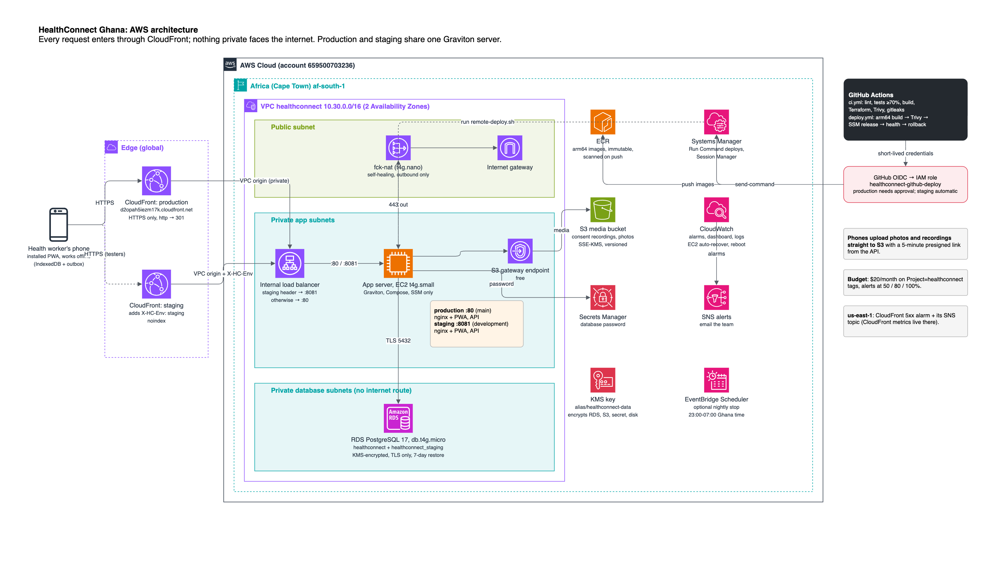

# HealthConnect Ghana: Team Handbook

Updated 29 Oct 2026 · Owner: Mubarak Tijani · A PDF copy is in [`TEAM_HANDBOOK.pdf`](TEAM_HANDBOOK.pdf)

> **Start here:** read [Team and deadlines](#team-and-deadlines) and [What each of us does next](#what-each-of-us-does-next). The other sections are reference. If anything here disagrees with the code or the other docs in the repo, the repo wins: open a PR to fix this file.

## Overview

HealthConnect Ghana is an offline-first web app (PWA). Community Health Volunteers use it to register patients, take vitals, and book visits and referrals, and health officers get a district summary. Feature freeze is **Mon 2 Nov, 12:00 GMT**. The hard deadline is **Tue 3 Nov 2026, 17:00 GMT**.

The brief describes four weeks of work. We're delivering a one-week MVP and showing the rest as clearly labelled mocks or future work. We don't claim live GHS or hospital integration, clinical validation, or full HIPAA compliance.

**Live now (29 Oct):**

| | URL | Updated from |
|---|---|---|
| Production (the demo we present) | https://d2opah5iezm17k.cloudfront.net | `main`, after approval |
| Staging (test here) | https://dwaho59wvxpxe.cloudfront.net | `development`, automatically |

Until the backend ships, both answer `/api/*` with `503 {"error":"api_unavailable"}`. The app treats that as offline and keeps working.

**What works today (frontend, demo mode):**

- Sign-in with a phone number and an SMS code. It uses demo accounts until the auth API exists.
- Patient registration in 3 steps, with real consent evidence: a voice clip, a signature or a thumbprint photo.
- Vitals with automatic warning flags. An urgent reading leads straight to **Refer today**.
- Visits and referrals: book, reschedule, mark done or missed. Nurses and doctors get a referral inbox.
- A district summary of anonymised counts for officers, with a fever early warning.
- Everything works offline. Records queue on the phone and sync when there's signal.
- An audit trail of who opened or changed which record, and an Activity page for the auditor.
- English, plus draft Twi, Ewe and Hausa. Dark mode.

## Team and deadlines

Each of us owns 25% and must hand in working code or config, tests and a short evidence note. Documentation alone doesn't replace an implementation (workplan rule).

| Person | Owns | Must hand in by Mon 2 Nov |
|---|---|---|
| Mubarak Tijani | Frontend, UI, DevOps | Installable PWA; patient, vitals and visit screens; offline indicator; Docker; CI; live demo URL and repeatable deploy steps |
| Bernard Marfo Adjei | Backend and APIs | Patient, vitals and visit endpoints with validation; role-aware API; API spec; tests; referral and teleconsult mock |
| Liza Aikins | Database, sync, analytics | ERD and migrations; models; synthetic seed data; sync and conflict policy with a working demo; surveillance aggregation and tests |
| Germain Emil Allotey-Pappoe | Security, community, documentation | Role-permission matrix; access checks and audit logging with Bernard; security test evidence; consent requirements; language and accessibility checklist; final report and demo script |

**Milestones** (all 18:00 GMT unless stated)

| When | What | Who |
|---|---|---|
| Fri 30 Oct | Connected patient and vitals: create and view with a permitted role, plus an offline queue trial | Bernard, Liza, Mubarak, Germain |
| Sun 1 Nov | Visits UI and deployment; referral mock; analytics; audit log; demo and report draft. Everything on staging | All |
| Mon 2 Nov 12:00 | **Feature freeze.** Hand in feature links, tests, screenshots and a one-paragraph contribution log | All |
| Mon 2 Nov | Integration testing, blocker fixes, demo rehearsal. Germain compiles the package | All |
| Tue 3 Nov 17:00 | **Final submission** (hard deadline) | Germain submits. Mubarak signs off deployment, Bernard the backend, Liza the data |

**Blockers:** a task counts as blocked once a handoff has been missing for **2 working hours**. Post it in the group chat as: task · blocked owner · blocking person · raised at · needed by · workaround. After **4 hours**, we agree on a mock or a simpler version together. No silent delays.

## Architecture

One Graviton server in a private network runs both production and staging. CloudFront is the only way in. The load balancer, server and database have no public address.

1. A phone talks to CloudFront over HTTPS.
2. CloudFront reaches the internal load balancer through a private VPC origin.
3. The load balancer sends staging traffic to port 8081 and everything else to port 80.
4. The server:
   - reads its database password from Secrets Manager;
   - pulls images from ECR;
   - keeps photos and recordings in S3. Phones upload those straight to S3 with a short-lived link.
5. A small NAT instance gives the server outbound internet access for packages.
6. GitHub Actions builds, scans and pushes the images, then releases them through Systems Manager.

The editable source is [`deploy/architecture.drawio`](../deploy/architecture.drawio). Open it in [diagrams.net](https://app.diagrams.net) to change it or to export a PNG for the report.

## How we work

All work goes through a pull request: **feature branch → `development` → `main`**. A merge into `development` updates staging by itself. A merge into `main` updates production once Mubarak approves the deploy.

| Folder | What lives there | Owner |
|---|---|---|
| `frontend/` | React PWA (Vite, TypeScript, Tailwind, Dexie offline database) | Mubarak |
| `backend/` | The API. Empty until Bernard adds it; deploys start the moment `backend/Dockerfile` exists | Bernard |
| `db/` | `schema.sql`, `rbac.sql`, `seed.sql` (FHIR-aligned, synthetic) | Liza designs, Bernard applies |
| `deploy/` | Terraform for AWS, `compose.yml`, the deploy script, the runbook (`deploy/README.md`) | Mubarak |
| `docs/` | API contract (`frontend-needs.md`), decision records (`adr/0001`–`0005`), this handbook | All |
| `.github/workflows/` | `ci.yml` (checks on every PR), `deploy.yml` (releases) | Mubarak |

**Making a change**

1. Run `git checkout development && git pull`, then `git checkout -b feature/<short-name>`. Use `fix/`, `docs/` or `devops/` in place of `feature/` where that fits better.
2. Commit in small, clear steps. Never commit secrets, `.env` files or real patient data: only synthetic records.
3. Push and open a PR **into `development`**. Fill in the template: what it does and how you tested it.
4. CI must be green. The one required check is **CI passed**.
5. A teammate reviews it, then it's merged with a merge commit.
6. Staging updates in about 4 minutes. Check your change there.

**What CI checks on every PR**

- **Branch flow:** only `feature/*`, `fix/*`, `docs/*` or `devops/*` may go into `development`, and only `development` into `main`.
- **Pre-commit hooks**, plus a **secret scan** (gitleaks).
- **Frontend:** lint, format, dependency audit, unit tests with at least **70%** line coverage, and a production build.
- **Docker:** the images build, and the frontend container is smoke-tested read-only.
- **Infrastructure:** Terraform format and validate, shellcheck, and a Trivy security scan that fails on critical findings.
- **Backend:** Bernard adds his test job with the same 70% coverage gate.

**Deploys** (`.github/workflows/deploy.yml`) run without anyone logging into a server:

1. Build arm64 images tagged with the commit SHA, and push them to ECR.
2. Block the release if Trivy finds a critical vulnerability that has a fix.
3. Release through AWS Systems Manager (no SSH): pull, start, and wait for the health check.
4. **Roll back automatically** if the new version isn't healthy.
5. Smoke-test through the public URL.

**Manual rollback:** GitHub → Actions → **Deploy** → Run workflow → pick the environment and paste an older commit SHA. Each run's summary lists its SHAs.

## Environments, URLs and demo accounts

There are two environments on one AWS server in Cape Town (af-south-1). Test on **staging**. **Production** is the demo we present.

| Environment | URL | Deployed from | Database |
|---|---|---|---|
| Production | [d2opah5iezm17k.cloudfront.net](https://d2opah5iezm17k.cloudfront.net) | `main`, after approval | `healthconnect` |
| Staging | [dwaho59wvxpxe.cloudfront.net](https://dwaho59wvxpxe.cloudfront.net) | `development`, automatically | `healthconnect_staging` |
| Your laptop | `http://localhost:5173` (`cd frontend && npm install && npm run dev`) | your branch | the browser's own database |

**Demo sign-in** (synthetic people; the code is **123456** for every account):

| Phone number | Name | Role | What they see |
|---|---|---|---|
| 020 000 0101 | Akosua Mensah | Community Health Volunteer | Home dashboard, patients, register, vitals, visits |
| 020 000 0102 | Efua Asante | Nurse / Midwife | The same patients, plus the **Referrals** inbox |
| 020 000 0103 | Kwesi Eshun | Doctor | The same as the nurse |
| 020 000 0104 | Yaw Darko | District Health Officer | **District summary** only: anonymised counts, no patient names |
| 020 000 0105 | Adwoa Boakye | Administrator (auditor) | The **Activity log** of every access and refused attempt, plus the summary |

Demo mode stays on until Bernard's sign-in endpoints are live. Then we build with `VITE_AUTH_MODE=api`, and real health-worker numbers get SMS codes.

**Try it offline:**
1. Open the app once.
2. Switch the phone to airplane mode and register a patient. The Sync page shows the record waiting.
3. Turn the signal back on. The record sends itself.

## API contract

The app talks only to `/api/*` on its own address. nginx forwards those requests to the backend container on port **8080**, so there's no CORS. Everything is JSON, sent with `Authorization: Bearer <token>`. The full field lists are in [`frontend-needs.md`](frontend-needs.md). This is the summary Bernard builds against.

| Method | Path | Body → result | Used for |
|---|---|---|---|
| POST | `/auth/code` | `{phone}` (+233…) → 204; 404 for an unknown number; 429 if requested too often | Sign-in step 1 (SMS) |
| POST | `/auth/verify` | `{phone, code}` → `{token, expiresAt, user:{id,name,role,district}}`; 401 for a wrong code | Sign-in step 2 |
| PUT | `/patients/{id}` | Patient → 200/201 | Sync |
| PUT | `/vitals/{id}` | Vitals → 200/201 | Sync |
| PUT | `/appointments/{id}` | Appointment (including `referralStatus`) → 200/201 | Sync, referral inbox |
| GET | `/patients?updatedSince=` | → Patient[] | Pulling others' changes (stretch goal) |
| GET | `/surveillance/weekly` | → rows of the `surveillance_weekly` view; cells under 5 come back null | District summary |
| POST | `/media/{id}/upload-url` | `{kind, mime, size, sha256, patientId, ownerEntity, ownerId}` → `{url, headers?}`: a presigned S3 PUT, valid 5 min | Consent recordings, wound photos |
| POST | `/audit-events` | `{events:[…]}` → 204 | The phone's audit trail |
| GET | `/health` | → 200 when the API and its database connection are up | Deploy health check |

**Rules the app depends on**

- **Ids come from the phone** (UUIDs), and saving is a `PUT` to that id. If a reply is lost on 2G and the phone sends the record twice, it's saved once.
- Every record carries `version`. A stale version → **409**. The phone keeps the change and shows *Needs review*. Liza's conflict policy decides what happens next.
- **401** signs the person out. **403** means the role isn't allowed: the change stays queued and is marked failed.
- **422** means validation errors, returned as `{errors:{field: message}}`.
- While there's no backend, nginx answers `/api/*` with **503** `{"error":"api_unavailable"}`. The phone treats that as offline and retries.
- **Take the user from the token**, never from the request body. This matters most for audit events.

**What the backend container gets** (environment variables): `DB_HOST`, `DB_NAME`, `DB_SECRET_ARN`, `DB_SSL_CA`, `MEDIA_BUCKET`, `AWS_REGION`, `PORT=8080`.
- The database password comes from AWS Secrets Manager at start-up, read with the server's own role. There's no password in code, config or `.env`.
- Connect with TLS and `sslmode=verify-full`, using the CA file at `DB_SSL_CA`.

## Data, consent and audit

Every record is saved on the phone first, in the phone's own database (IndexedDB), and sent to the server later. So the server must accept records it hasn't seen before, in any order, and more than once.

| Record | Key fields | Notes |
|---|---|---|
| Patient | id, names, sex, dateOfBirth (+ `birthDateEstimated`), phone?, nationalId?, community, district, preferredLanguage, consent, version | If the exact birth date is unknown, it's set to 1 July of the estimated birth year |
| Vitals | id, patientId, takenAt, systolic/diastolic, temperatureC, pulse, weightKg, heightCm, notes | Needs at least one measurement. Flags (high BP, fever…) are computed, not stored |
| Appointment | id, patientId, type (follow_up, antenatal, postnatal, referral, teleconsult), scheduledAt, facility, priority, status, referralStatus? | A referral goes from requested to accepted or declined, then to seen |
| Media | id, patientId, owner record, kind, mime, size, **sha256** | Consent recordings and wound photos. The file goes straight to S3 |
| Audit event | id, at, actor, role, action (view, create, update, denied), entity, patientId?, outcome, purpose | One for each save, each record opened and each refused page |

**Consent** comes before any health data is saved (Act 843 s.20, s.37). The health worker reads statement **v1** in the patient's language, then captures proof in one of three ways:

- **Spoken:** a voice clip of up to 30 seconds.
- **Signature:** drawn with a finger.
- **Thumbprint:** a photo of the inked thumb on the paper form. There's no biometric scan.

A phone that can't record falls back to a named witness. The record keeps:
- the method;
- the statement version and language;
- who asked and who witnessed;
- the file's SHA-256, so any later change to the file can be detected.

**Audit trail**
- The phone records each access as it happens, offline too, and uploads the events after the records.
- The server appends them to `access_log`. That table is hash-chained and append-only: an update or delete is refused, and `verify_access_log()` proves nothing was changed (Lab 6).
- The auditor sees the trail on the **Activity** page, and each patient page shows **Who opened this record**.

**Database** (`db/schema.sql`):
- FHIR-aligned tables: `patients`, `patient_identifiers`, `consents`, `observation_codes` (LOINC codes with UCUM units and plausible ranges), `observations` and `access_log`.
- The database roles `hc_chv`, `hc_clinician`, `hc_ghs_official` and `hc_auditor` have row-level security by district.
- The `surveillance_weekly` view hides any count under 5.

## Security and privacy

Our legal basis is the patient's **consent**, not the health-professional exemption: CHVs aren't health professionals under Ghana's Data Protection Act, 2012 (Act 843, s.37(2)(b)). So nothing is saved without recorded consent.

| Area | What we do | Where |
|---|---|---|
| In transit | HTTPS only. `http://` redirects (301), `/api` over HTTP is refused (403), and the database refuses non-TLS connections | CloudFront, RDS `rds.force_ssl` |
| At rest | The database and its backups, the password secret and the photos bucket are all encrypted with our own KMS key, which rotates yearly | `deploy/terraform/kms.tf` |
| Network | Nothing private is on the internet. The load balancer, server and database sit in private subnets, and CloudFront reaches them over a private VPC origin | `network.tf`, `alb.tf` |
| Access to AWS | The server's role can read one secret, one bucket and its own images. It has no `rds:*` and no IAM. Deploys use short-lived GitHub OIDC credentials, with no stored keys | `iam.tf`, Lab 6 |
| Server access | No SSH and no open port. Session Manager only, and it's logged | `compute.tf` |
| People | Roles: CHV, nurse, doctor, district officer, auditor. Officers see only anonymised counts (none under 5). Every access and refused attempt goes in the audit trail | The app and `db/rbac.sql` |
| Code | Secret scanning, a dependency audit, and image and config scanning on every PR and release | `ci.yml`, `deploy.yml` |

**Never:**

- Put real patient data anywhere: code, tests, screenshots, the report or chat. Use synthetic records only.
- Commit passwords, keys, tokens or `.env` files. Gitleaks blocks the PR if you do.
- Paste AWS credentials in chat. Mubarak runs anything that needs the AWS account.
- Claim HIPAA compliance, clinical validation, or a live GHS or hospital integration in the report.

## What each of us does next

The frontend and the AWS setup are done. Staging and production went live on 29 Oct and are waiting for the API. These lists are what's left between us and the **Fri 30 Oct** end-to-end checkpoint. Tick items off in a PR as you go.

> **Who changes the database:** Bernard makes every change to the live database the API uses: migrations, new columns, the API's queries. Liza owns the data design (ERD, schema review, seed data, sync and conflict policy, analytics) and reviews Bernard's migrations, but doesn't apply them herself. With one person changing the schema, there are no clashes and nothing gets out of step with the API.

**Bernard (backend)**

- [ ] Add `backend/` with a `Dockerfile`.
  - The container listens on **8080** and answers `GET /health` with 200 once the database is reachable.
  - The next merge into `development` deploys it to staging automatically.
- [ ] At start-up, read the database password from Secrets Manager (`DB_SECRET_ARN`). Connect over TLS with `sslmode=verify-full` and `DB_SSL_CA`.
- [ ] Database migrations, including the consent change. Liza reviews them before they're merged.
  - Add `statement_version`, `language`, `witness`, `evidence_key` and `evidence_sha256` to `consents`.
  - Rename the method `verbal` to `spoken`; the app already sends `spoken`.
- [ ] Patient, vitals and appointment endpoints as `PUT /<entity>/{id}`. They must be idempotent, check `version` (409), and return validation errors as 422.
- [ ] `POST /auth/code` and `POST /auth/verify`. For the demo the SMS can be logged instead of sent; say so in the API spec.
- [ ] Role checks on every endpoint, following Germain's matrix. Take the user from the token, never from the body.
- [ ] `POST /audit-events`: append to `access_log` and ignore ids that are already stored.
- [ ] `POST /media/{id}/upload-url`: a presigned S3 PUT, with these limits:
  - it's valid for 5 minutes;
  - files are at most 2 MB;
  - only `audio/*`, `image/png` and `image/jpeg` are accepted;
  - it's only issued for a patient the caller may write to.
- [ ] `GET /surveillance/weekly`, served from Liza's view.
- [ ] Referral mock: accept, decline and seen, through `PUT /appointments/{id}`.
- [ ] An API spec (OpenAPI) in `docs/`, plus a CI test job with at least **70%** coverage.

**Liza (database, sync, analytics)**

- [ ] Review Bernard's consent migration (the new columns, and `verbal` renamed to `spoken`) against the ERD before it's merged.
- [ ] Write the conflict policy for a 409 and give it to Bernard. For example: last writer wins for vitals, and a review step for patient details.
- [ ] Synthetic seed data that matches the app's demo district (Shai-Osudoku) and the five demo users.
- [ ] A sync demo for the checkpoint: record on a phone while offline, go online, then show the row in the database.
- [ ] Tests for the aggregation view, including that cells under 5 are hidden.

**Germain (security, community, documentation)**

- [ ] Confirm the role matrix. It now has five roles: CHV, nurse, doctor, district officer and **auditor**, who sees the Activity log.
- [ ] Sign off consent statement **v1** (`frontend/src/i18n/locales/en.json`, key `newPatient.statement`). Find native speakers to check the Twi, Ewe and Hausa drafts, starting with the health instructions.
- [ ] Collect security test evidence:
  - the output of `deploy/verify/*.sh`;
  - a refused page in the Activity log;
  - the CI security scans;
  - the accessibility results (0 WCAG AA issues on 30 screens).
- [ ] The language and accessibility checklist, the limitations section of the report, and the demo script.

**Mubarak (frontend, DevOps)**

- [x] AWS changes applied on 29 Oct: arm-based server, private load balancer, staging, monitoring.
- [x] PRs #1–#14 merged into `development`.
- [x] Staging deployed from `development`, and production released from `main` (PR #15, approved), both on 29 Oct.
- [ ] Confirm both AWS alert emails.
- [ ] Load-test staging with k6. Record the demo. Collect screenshots for the report.
- [ ] Once the demo is recorded, turn on the nightly stop to save money.
- [ ] Switch to `VITE_AUTH_MODE=api` once Bernard's sign-in is live.

## Operations

The system is set up to fix the common failures by itself and to email us about the rest. It costs about **$2.25 a day** to run. The full runbook is [`deploy/README.md`](../deploy/README.md).

**Monitoring and alerts:** everything shows on the CloudWatch dashboard **healthconnect**. Alarms email the addresses set in the Terraform settings.

| Signal | What happens |
|---|---|
| The AWS hardware under the server fails | The server is recovered onto healthy hardware automatically, and we get an email |
| The server's operating system hangs | It reboots automatically, and we get an email |
| No healthy production server for 3 minutes | An email, and another when it's back |
| More than 10 server errors in 5 minutes, or the slowest 10% of responses take over 2 s | An email |
| More than 5% of requests fail at the CloudFront edge (what users see) | An email |
| Database CPU over 80%, storage under 2 GB, or memory under 64 MB | An email |

**Logs:** CloudWatch Logs, group `/healthconnect/app`, with one stream per container, kept for 30 days. Ask Mubarak for access or for a log extract.

**Backups and recovery**

- **Database:**
  - a daily backup, plus point-in-time restore to any second of the last 7 days;
  - it's protected from deletion;
  - the target is to lose at most **5 minutes** of data (RPO) and be back in about **30 minutes** (RTO);
  - `deploy/ops/restore-drill.sh` proves the restore works.
- **Photos and recordings:** S3 keeps previous versions for 30 days, so a deleted file can be brought back.
- **Phones:** every record stays on the phone until the server confirms it. A server outage only delays sync; nothing is lost.

**Costs**

| | Per day | Per month |
|---|---|---|
| Before the 28 Oct changes | $2.69 | ~$82 |
| Now: arm-based server and database, private load balancer | ~$2.25 | ~$68 |
| With the nightly stop (23:00–07:00 Ghana time) | ~$1.90 | ~$58 |

- A $20 monthly budget sends alerts at 50%, 80% and 100%.
- Over a one-week course we stay well under it. A full month at this rate would go over, so expect the forecast alert.
- After the demo is recorded, turn on the nightly stop, or stop the server between demos.

## Known gaps, mocks and future work

We state all of this plainly in the report and the demo. It's the honest scope of a one-week MVP, and markers reward that more than overclaiming.

| Item | Status now | What production would need |
|---|---|---|
| Sign-in | Demo accounts, code 123456 | Bernard's SMS endpoints and an SMS provider |
| Twi, Ewe, Hausa | Machine-drafted and labelled *Draft* in the app. Some browsers show weekday and month names in English | Native-speaker review, health instructions first |
| Dagbani | Not offered ("Coming soon") | A native speaker to translate and check it |
| Teleconsult video, prescriptions, payments, NHIS | Not built (weeks 2–4 of the brief). Referral and teleconsult are booking flows only | WebRTC, pharmacy, mobile-money and NHIA integrations |
| Outbreak detection | A simple "fever rising" rule on demo data | A validated epidemiological method on real data |
| 99.7% uptime | One server, one single-zone database | Servers in two zones behind the load balancer, and a Multi-AZ database (ADR 0005 §7) |
| TLS between CloudFront and the load balancer | Runs on AWS's private network, but over plain HTTP | A custom domain with a certificate |
| Production and staging | They share one server and one database instance | Separate accounts or servers |
| Biometrics | A photo of an inked thumbprint, no fingerprint scan | Not planned: storing biometrics adds Act 843 s.37 risk |
| Speech to text | English only, recognised on the phone, and hidden where the phone can't do it | On-device models for local languages |

## Links and glossary

- Repo: [pull requests](https://github.com/ASU-MICS-2028/cc-group-1-prosit-2/pulls) · [Actions (CI and deploys)](https://github.com/ASU-MICS-2028/cc-group-1-prosit-2/actions)
- Production: https://d2opah5iezm17k.cloudfront.net · Staging: https://dwaho59wvxpxe.cloudfront.net
- In the repo:
  - [`docs/frontend-needs.md`](frontend-needs.md): the API contract
  - [`docs/adr/`](adr/): the decision records (stack, design, security, sign-in, hosting)
  - [`deploy/README.md`](../deploy/README.md): the runbook
  - [`deploy/architecture.drawio`](../deploy/architecture.drawio): the architecture diagram, editable in diagrams.net
- Briefs: *Prosit 2* and the *one-week team workplan*, both in the group chat

| Term | Meaning |
|---|---|
| CHV | Community Health Volunteer: the main user, working in villages with weak signal |
| PWA | A web app you install from the browser; it works offline |
| Outbox | The phone's queue of changes waiting to sync |
| Staging / production | The team's test site (from `development`) / the demo site (from `main`) |
| FHIR | The health-data standard our records follow (Patient, Observation, Consent, AuditEvent) |
| Act 843 | Ghana's Data Protection Act, 2012 |
| RPO / RTO | How much data we could lose / how long recovery takes |
| OIDC | How GitHub gets short-lived AWS access without stored keys |
| VPC origin | CloudFront's private connection into our network |
