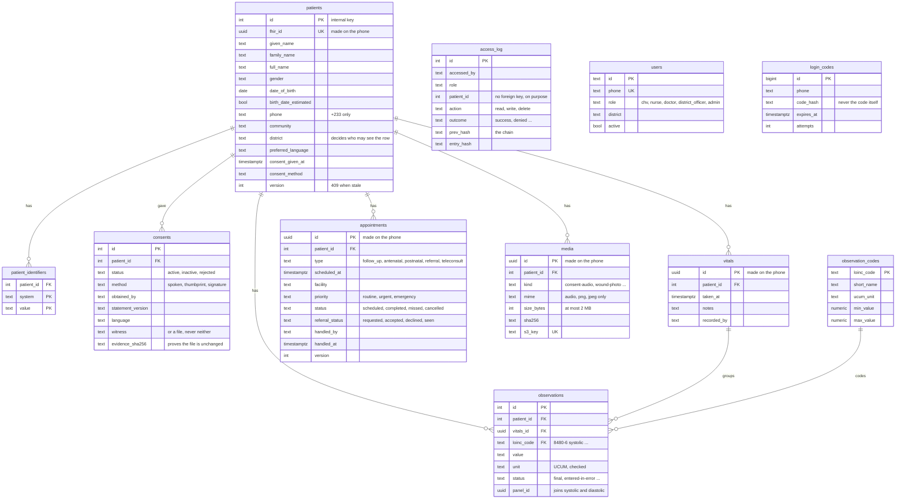

# The database

PostgreSQL 17 on RDS (`healthconnect` for production, `healthconnect_staging` for staging). The tables are shaped like FHIR R4 resources, and the database itself enforces who may see what and which values are allowed, so a bug or an old app version cannot store nonsense or show a patient to the wrong person. Synthetic data only.

Where it is defined: **the SQL migrations in `backend/Services/Libs/Data/Migrations/Sql/`**, applied by the API when it starts. Migration 1 is Liza's Lab 6 `db/schema.sql` + `db/rbac.sql` unchanged; migration 2 adds what the app needs beyond them. [`db/`](../../db/README.md) keeps the Lab 6 originals and the sample data.

## The tables (ERD)

`surveillance_weekly` is a **view** on `observations` and `patients`: district, week, and the counts of patients seen, with high blood pressure, and with fever. Any count under 5 patients comes back empty (`NULL`, `suppressed = true`).

`access_log` has no foreign key on purpose: it must record an attempt on a record that is missing or that the person may not see, and it must survive if a patient row is ever removed. `users` and `login_codes` are not linked to anything by a foreign key: a sign-in code is checked by phone number before the person is known.

## How the tables map to FHIR

| Table | FHIR resource | Notes |
|---|---|---|
| `patients` | Patient | `fhir_id` is `Patient.id`; the phone makes it so an offline record has an id before it reaches the server |
| `patient_identifiers` | Patient.identifier | `system` + `value`; one identifier belongs to one patient |
| `consents` | Consent | The history of every decision, including withdrawal (Act 843 s.20), with proof |
| `observations` | Observation | One row per measurement, coded with LOINC and UCUM; blood pressure is two rows that map to one 85354-9 panel |
| `vitals` | (the group of Observations from one visit) | Keeps the phone's own id so the same reading is never saved twice |
| `appointments` | Appointment (visits) and ServiceRequest (referrals, teleconsults) | |
| `access_log` | AuditEvent | |
| `media` | Media | The file is in S3; the database keeps its hash and where it is |
| `users` | Practitioner | Future: the MVP only needs who may sign in |

## Who may do what

The API acts as one of four database roles for every request (`SET LOCAL ROLE ...`, then the person's district), so Postgres itself refuses the wrong thing even if the API has a bug.

| | `hc_chv` (CHV) | `hc_clinician` (nurse, doctor) | `hc_ghs_official` (district officer) | `hc_auditor` (`admin` in the app) |
|---|---|---|---|---|
| Patients, vitals, readings, consents, appointments, media | **own district** read and write | **all districts** read and write | none | none |
| Delete anything | never | never | never | never |
| `access_log` | add only | add only | add only | **read** + add + verify |
| `surveillance_weekly` (district counts) | no | yes | yes | yes |
| `users`, `login_codes` | no | no | no | no (only the API's own login) |

A wrong reading is marked `entered-in-error`, as FHIR does; it is never deleted.

## Rules the database enforces by itself

Every one of these has a test in `backend/tests/Data.Tests`.

- **Vital signs are plausible.** Only the six LOINC codes, with their UCUM unit, and inside a range (for example systolic 50 to 260 mmHg, temperature 30 to 45 °C). Fahrenheit, free text and made-up codes are refused.
- **Consent has proof.** A consent needs a recording, signature or thumbprint photo (with its SHA-256), or a named witness. The method is `spoken`, `thumbprint` or `signature`.
- **Phones are Ghana numbers** in international form (`+233` and 9 digits). A birth date is never in the future.
- **Appointments make sense.** Only a referral or a teleconsult has a referral status, and who handled it and when are recorded together.
- **Files are small and safe:** audio, PNG or JPEG only, at most 2 MB, with a real hash and their own storage key.
- **The audit log cannot be changed.** No update, delete or truncate. Each entry carries the hash of the one before, and `verify_access_log()` finds the first entry that does not add up if anyone rewrites history.
- **A small village cannot be picked out.** The summary shows no count under 5.

## Changing the database

1. Add `backend/Services/Libs/Data/Migrations/Sql/000N_what_it_does.sql` and a class next to `20261109000002_ClinicalRecords.cs` with a new `[Migration("yyyyMMddHHmmss_Name")]` (copy that file).
2. **Never edit a migration that has been merged.** Add a new one.
3. **Keep it additive.** Add columns and tables; do not drop or rename. The previous release must keep working if a deploy is rolled back. Remove old things in a later migration, after nothing uses them.
4. Write the SQL so it can run twice (`IF NOT EXISTS`, `DROP POLICY IF EXISTS` then `CREATE POLICY`).
5. Add a test in `Data.Tests` for any new rule or permission.
6. Check it on your laptop: `dotnet ef migrations list --project Services/Libs/Data --startup-project APIs/healthconnect-api --configuration Release` (from `backend/`). Note the long `--configuration`: in `dotnet ef`, `-c` means "context".

**On a deploy** the new API applies its migrations when it starts, in one transaction each, with a lock so two containers cannot clash. `/health` stays red (503) until every migration has been applied, so the pipeline rolls the release back if one fails and the old version keeps running on the old, still-compatible schema.

## Known limits

- The API connects to RDS as the master login `healthconnect`, which owns the tables. It is not a superuser, and the security tests run as a login like it, but a dedicated, lower-privilege login for the API would be better. That needs a second secret and a change in Terraform.
- Migration 1 can run on a database that already had Lab 6's `schema.sql` applied by hand, so nobody has to check what is on RDS first.
- The audit log's hash covers who, what, when and the outcome. The extra columns for the app's own audit events (event id, entity, detail) arrive with the audit endpoint and will be tested there.
